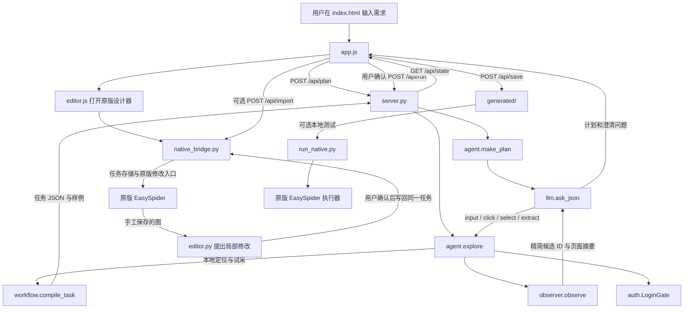
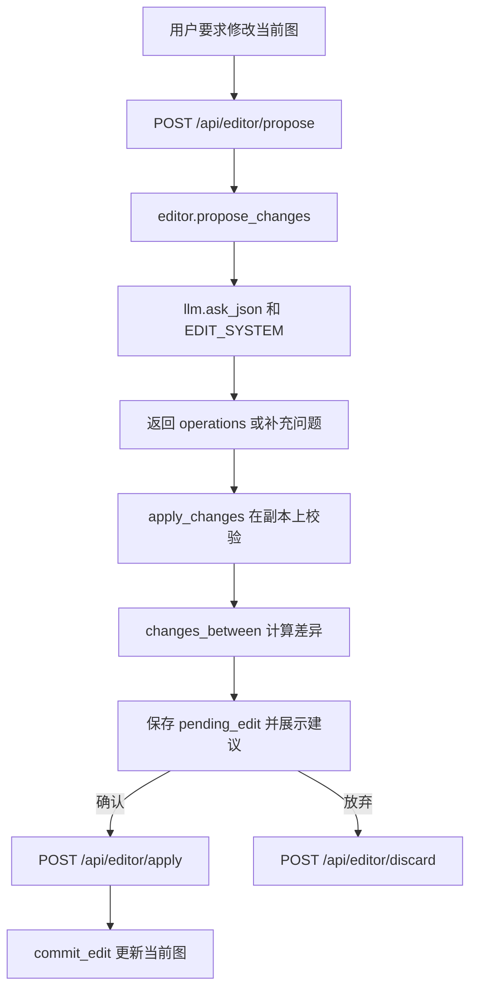
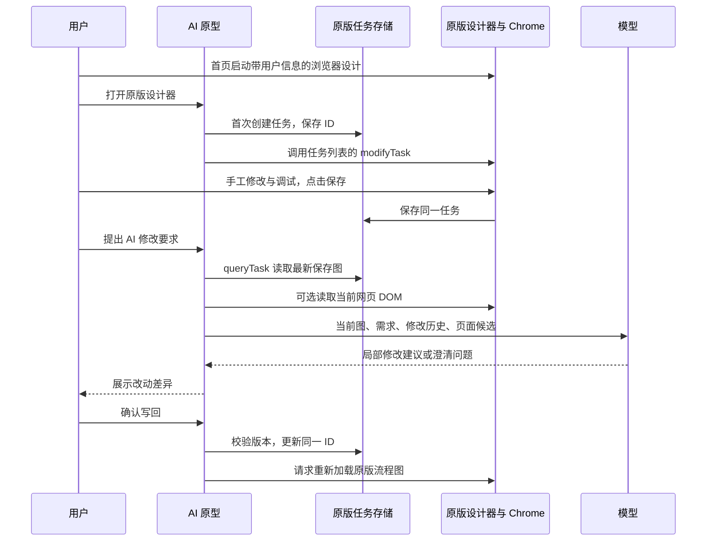

# ai-rpa-prototype 项目结构与代码导览

本文按当前代码说明各目录、模块和主要函数的职责。使用说明与命令示例见 [README.md](README.md)，测试需求见 [TEST_CASES.md](TEST_CASES.md) 和 [CAPABILITY_AND_AUTH_TEST_PLAN.md](CAPABILITY_AND_AUTH_TEST_PLAN.md)。

## 1. 项目定位与依赖边界

本项目是 EasySpider 之外的实验性流程生成器。它先让模型根据用户需求生成计划；用户确认后，Selenium 打开真实网页，模型根据页面候选 ID 选择受限动作；本地代码试采并把动作编译为 EasySpider 原生任务 JSON。原型提供只读流程图，手工修改和调试使用原版设计器。保存 JSON 不会自动创建 EasySpider 任务；首次点击“在 EasySpider 原版设计器打开流程”或导入才创建任务。AI 从原版读取最新保存的图并在用户确认后写回同一任务，详见第 11 节；只读流程图及同步刷新详见第 12 节。

Python 依赖见 [requirements.txt](requirements.txt)：`selenium` 用于网页探索，`lxml` 用于检查生成的 XPath。模型调用使用 Python 标准库 `urllib`，前端使用原生 HTML/CSS/JavaScript。`tests/` 中部分复杂案例还会使用 `openpyxl`；它不是主程序的运行依赖。

**独立目录不等于完全独立运行。** Windows 上，`agent.py` 默认寻找同一工作区中的 `../EasySpider/ElectronJS/chrome_win64/chrome.exe` 和匹配的 ChromeDriver；`run_native.py` 还需要这个目录中的原版 `easyspider_executestage.exe`，以及 README 所述的隔离资源目录连接。只克隆本 GitHub 仓库、没有原版 EasySpider 时，可以查看或修改代码，但不能直接完成默认的原版执行器联调。可通过 `AI_RPA_CHROME_BINARY` 和 `AI_RPA_CHROMEDRIVER` 指定探索阶段的其他匹配版本；`run_native.py` 当前仍要求 Windows 版自带执行器。

## 2. 目录总览

```text
ai-rpa-prototype/
├─ index.html              # 单页测试界面的结构和样式
├─ app.js                  # 前端状态、对话、轮询和按钮行为
├─ editor.js               # 打开原版设计器、读取原版、AI 建议与确认写回
├─ flowchart.js            # 只读流程图、嵌套循环/分支、节点详情与缩放
├─ flowchart.css           # 流程图画布、节点配色与响应式布局
├─ server.py               # 本地 HTTP 服务、会话状态和导入接口
├─ settings.py             # .env、模型配置、对话及动作上限
├─ llm.py                  # DeepSeek / GPT / Gemini 的 JSON API 适配
├─ agent.py                # 规划、受限浏览器探索、试采与风险判断
├─ observer.py             # DOM 候选、同类列表、翻页候选和 XPath
├─ dom_observer.js         # Selenium 内执行的通用 DOM 扫描、列表评分与清理 DOM
├─ auth.py                 # 登录检测、站点 Profile、人工登录接管
├─ workflow.py             # 将动作编译、校验为 EasySpider 任务图
├─ editor.py               # 在既有原生任务图上应用、校验局部修改
├─ native_bridge.py        # 原版任务存储、连接现有设计 Chrome、打开与刷新原版图
├─ debugger.py             # 旧版原型节点调试后端；当前默认界面不使用
├─ run_native.py           # 用设计时 Profile 调用原版执行器
├─ requirements.txt        # 主程序 Python 依赖
├─ .env.example            # 不含真实 Key 的配置模板
├─ .gitignore              # 排除密钥、Profile、生成结果和临时文件
├─ README.md               # 安装、使用和限制
├─ PROJECT_STRUCTURE.md    # 本文
├─ TEST_CASES.md           # 功能测试案例
├─ CAPABILITY_AND_AUTH_TEST_PLAN.md # 能力与登录测试方案
├─ tests/                  # 单元、浏览器、模型和原版执行器测试
├─ generated/              # 保存的计划、任务 JSON 与诊断结果；不提交
├─ profiles/               # 站点专属 Chrome 用户资料；不提交
├─ executor_sandbox/       # 原版执行器任务副本、日志和输出；不提交
├─ browser_tmp/            # 非持久浏览器资料；不提交
├─ inputs/                 # 本机 Excel 输入文件；不提交
├─ .env                    # 本机 API Key 与配置；不提交
├─ .venv/、.deps/          # 本地依赖；不提交
└─ __pycache__/            # Python 缓存；不提交
```

`profiles/` 可能包含 Cookie、登录状态和浏览器历史；`generated/`、`executor_sandbox/` 可能包含真实网页数据。它们都已经由 `.gitignore` 排除。不要用 `git add -f` 强制提交这些目录。

## 3. 一次任务的调用链



状态通常按 `new → planned/clarifying → running → preview → saved` 变化；登录时暂为 `awaiting_login`，异常时为 `error`，自动控制浏览器被关闭时为 `closed`。会话保存在 `server.py` 的进程内字典中；浏览器刷新可凭 `sessionStorage` 中的会话 ID 恢复页面，重启 Python 服务则会丢失会话。

规划阶段只发送需求和已有计划，不打开目标网站。探索阶段的 `observer.observe()` 在浏览器本地默认获得最多 1000 个可见元素、80 组重复列表、翻页候选和最多 6000 字符正文；`agent._compact()` 把正文再截到 4000 字符，删除候选原始 XPath，再交给模型。模型通过 `e1`、`l1` 等 ID 选择，本地用保留的 XPath 操作并生成任务。模型可补充至 3000 个元素，也可按需读取局部或整页清理 DOM；探索和详情页共用最多 12 次补充预算。此前实际动作可能把 XPath 和输入文字作为上下文传回模型。未经清理的原始 HTML、完整可访问性树和 Cookie 不作为观察结果发送。第一轮搜索修复见第 13 节；当前通用列表与分层 DOM 见第 14 节。

`extract` 可以选择单项或同类列表。列表候选由原型的 DOM 同级元素分组启发式发现；模型只选择一组和第一条中的字段。最终任务使用 EasySpider 的原生列表循环和相对字段 XPath 处理其余记录。这个候选发现过程并非直接调用 EasySpider 设计器内部的自动选同类算法。

## 4. 功能文件与函数

### `settings.py`：配置读取

| 函数或常量 | 作用 |
| --- | --- |
| `MAX_PLAN_TURNS`、`MAX_USER_MESSAGE_CHARS` | 服务端执行的对话轮数与单条消息字数上限，当前分别为 15 和 1000。 |
| `read_env(path)` | 从本机 `.env` 读取 `NAME=value`，忽略空行与注释，不依赖第三方 dotenv 包。 |
| `setting(name, env)` | 按进程环境变量优先、`.env` 其次读取设置。 |
| `resolve_model_config(data, env)` | 合并前端临时输入与本机配置，确定 provider、API Key 和模型名；切换 provider 时选择相应默认模型。 |
| `max_actions(env)` | 校验 `AI_RPA_MAX_ACTIONS`，控制首次网页探索中的动作数量，默认 30。 |
| `risk_review_enabled(env)` | 判断是否启用额外一轮模型风险复核。 |
| `public_config(env)` | 只把服务名、模型名、是否配置 Key 和限制值返回前端，不返回 Key 本身。 |

`.env.example` 是配置模板。模型默认值在 `llm.py` 和 `app.js` 中也有定义；部署时以实际 `.env` 或界面选择为准。

### `llm.py`：模型 API 适配

| 函数或常量 | 作用 |
| --- | --- |
| `DEFAULT_MODELS` | 各 provider 的后端默认模型。 |
| `_post(url, payload, headers)` | 使用 `urllib.request` 发送 JSON 请求并读取响应，给 HTTP 错误附加状态和响应摘要。 |
| `_decode_object(output)` | 接受一个 JSON 对象或包在单个 Markdown JSON 代码块里的对象；区分空内容、无效 JSON 和非对象。 |
| `ask_json(provider, api_key, model, system, user, screenshot_b64)` | 组装 DeepSeek、OpenAI GPT 或 Gemini 请求；三种接口均支持附 PNG，检查模型输出是否截断；解析失败时保留截图并附加简短 JSON 要求再试一次，第二次提高输出预算；API 请求异常直接抛出。 |

DeepSeek 默认使用支持图片输入的 `deepseek-flash`；DeepSeek Flash、GPT/Gemini 在探索条件允许时都可附 PNG 截图。DeepSeek 与 GPT 通过用户消息中的 `image_url` 发送 Base64 PNG，Gemini 通过 `inline_data` 发送。图片请求失败会抛出异常并由界面显示，不自动转为文字请求。格式依据 [DeepSeek Vision 官方文档](https://api-docs.deepseek.com/guides/vision)。模型 API 调用可能把当前页面摘要和截图发给第三方服务，因此应只用有权访问且允许传输的网页。

### `auth.py`：人工登录接管

| 函数或方法 | 作用 |
| --- | --- |
| `profile_path(url)` | 根据站点域名生成稳定的 `profiles/<站点>_<哈希>` 目录，使同一站点下次探索可复用登录信息。 |
| `detect_challenge(driver, start_url)` | 只检查可见登录遮罩、密码框、验证码、登录地址等信号，返回简短原因；不读取表单值。 |
| `LoginGate.__init__` | 记录资料目录、状态回调、等待事件和超时时间。 |
| `LoginGate.acquire()` / `release()` | 防止同一进程内两次探索同时使用同一个站点 Profile；准备或释放目录。 |
| `LoginGate.complete()` / `cancel()` | 接收前端“已完成登录”或取消指令，唤醒等待线程。 |
| `LoginGate.wait_for_login()` | 暂停浏览器探索，等待用户自行登录；随后重开起始页并检测登录是否成功，最多验证三次。 |

登录输入本身不编译为流程节点。`agent.explore()` 有 `login_gate` 时使用持久 Profile；没有时使用 `browser_tmp/` 下的临时 Profile。

### `observer.py`：页面候选和本地定位

| 函数或常量 | 作用 |
| --- | --- |
| `OBSERVE_JS` | 从 `dom_observer.js` 读取浏览器脚本，共用候选、XPath、通用列表和清理 DOM 的实现。 |
| `observe(driver, with_screenshot, *, focus, expanded)` | 执行常规观察；可选取得 PNG 截图，按重点和预算返回候选与覆盖统计。 |
| `inspect_dom(driver, snapshot, *, scope, candidate_id, depth, offset, max_chars)` | 只允许已知候选或主文档作为根，读取清理 DOM，保留旧 ID 并注册新元素和列表，校验分页指纹。 |
| `model_elements(snapshot)` | 从本地 ID 注册表挑出本次应交给模型的候选；注册表保留已读元素，新块优先提供，补足原始候选。 |
| `candidate(snapshot, candidate_id, kind)` | 在当前快照的元素或列表集合中查找指定 ID；若 ID 不存在，给出当前可用 ID。 |
| `input_target(snapshot, candidate_id)` | 把输入候选或只有一个可编辑后代的容器映射到真正可输入元素的 XPath。 |
| `_has_direct_risk_intent(label)` | 辅助判断控件标签是否表达直接的支付、购买、删除等动作，并处理部分否定语境。 |
| `check_action_target(element, action)` | 对模型要求点击的实际控件做最终本地高风险拦截。 |
| `validate_url(url)` | 仅接受普通 HTTP(S) 地址，拒绝带用户名/密码的 URL。 |

候选发现时使用页面结构评分，**尚未实现通用 iframe 内部观察**。原始 XPath 主要留在本地快照中，模型决策时应返回候选 ID。

### `agent.py`：规划、探索、试采与异常恢复

`PLAN_SYSTEM`、`ACT_SYSTEM`、`DETAIL_SYSTEM`、`RISK_SYSTEM`、`RECOVERY_SYSTEM` 分别规定计划、页面动作、详情字段、风险复核和点击拦截恢复的 JSON 格式。允许的探索工具是 `input`、`click`、`select`、`scroll_until_end`、`observe`、`inspect_dom`、`extract`；后两种观察工具只读。模型不能返回自定义脚本或直接指定 XPath。`LoginRequired` 表示详情试采需要人工登录；`BrowserClosedError` 将浏览器关闭错误转换为简短状态。

| 函数 | 作用 |
| --- | --- |
| `_is_browser_closed_error(exc)` | 识别 Selenium 会话失效、窗口关闭和 DevTools 断连；避免把驱动堆栈展示到界面。 |
| `_safe_runtime_url(driver)` | 读取当前地址并去掉查询参数和锚点，供异常恢复决策使用。 |
| `_runtime_recovery_decision(...)` | 点击被遮罩拦截后，向模型提供截短并脱敏的异常与登录信号，只允许返回 `human_login`、`retry`、`abort`。 |
| `_recover_intercepted_click(...)` | 执行上述受限恢复选择；检测到登录信号时优先交给 `LoginGate`，短暂遮罩可重试。 |
| `_unused_legacy_recover_intercepted_click(...)` | 早期仅靠本地登录信号处理点击拦截的遗留函数；当前主流程不调用。 |
| `_has_high_impact_action(step)` | 对计划步骤作本地兜底检查，区分“点击购买”和“不要点击购买”。 |
| `_redact_risk_context(value, depth)` | 递归移除供额外风险审核使用的凭据形态字段，并限制深度和长度。 |
| `_normalise_risk(raw, source, fallback, error)` | 校验模型风险判断的等级、类别、理由和是否可继续；无效响应采用保守回退。 |
| `assess_risk(...)` | 可选的独立模型风险复核，对计划或具体点击使用结构化上下文。 |
| `make_plan(request, url, provider, key, model, history, answers)` | 把当前需求、历史需求、上一版计划及补充信息交给模型；检查起始网址、字段、步骤、风险、澄清问题和页数，生成可确认的计划。 |
| `_compact(snapshot)` | 生成模型输入：候选 ID、语义与父节点关系、列表通用特征、按需 DOM 分块；候选 XPath 留本机，正文截到 4000 字符。 |
| `_screenshots_allowed(plan, login_gate)` | 统一探索、候选刷新和详情观察的截图条件；计划要求登录或本次已人工接管登录时不附截图，不按 provider 排除 DeepSeek。 |
| `_available_candidate_ids(snapshot)` | 另外列出当前有效的元素、列表和翻页 ID，降低模型臆造或使用旧 ID 的概率。 |
| `_navigation_context(plan, snapshot)` | 检查当前 HTTP(S) 网页地址，提供起始与当前主机名、是否跨域；正常跨域可以继续探索。 |
| `_field_name(name)` | 限制字段名长度并拒绝空名、换行等非法内容。 |
| `_check_pagination_decision(plan, snapshot, decision)` | 保证需要翻页的计划选择了下一页候选，单页计划没有误选翻页。 |
| `_stable_relative_xpath(first_row, target, class_name, tag, rows)` | 优先从字段 class 构造对多个列表项更稳定的相对 XPath，少依赖第几个子节点。 |
| `_guard_list_records(driver, list_xpath, rows, fields)` | 当同级列表混有问卷或推荐卡片时，尝试按采集字段存在性过滤；如果被排除卡片含其他目标字段则保留，以免误删不完整商品。 |
| `_prepare_extract(snapshot, decision, driver)` | 校验模式、列表和字段；可合并 `list_ids` 多组并检查字段兼容，生成相对 XPath 和等待条件，试采最多五条。 |
| `_probe_detail(...)` | 打开首条详情，处理新标签页与登录信号；支持补充观察和 DOM 读取，使用主探索剩余预算，选择字段并试采一条。 |
| `_scroll_until_end(driver, max_scrolls)` | 有上限地滚动，页面高度和正文长度连续稳定后停止。 |
| `_input_excel_path(plan)` | 仅接受 `inputs/` 下已存在的 `.xlsx` 文件名，拒绝任意路径。 |
| `_wait_for_loading_placeholders(driver, timeout)` | 在观察前短暂等待明显的骨架屏或忙碌占位元素消失。 |
| `explore(request, plan, provider, key, model, progress, max_actions, login_gate)` | 核心循环：启动 Chrome、打开起始页、检测登录、观察页面、调用模型、校验并执行受限动作、重新观察；收到 `extract` 后试采并调用 `workflow.compile_task()`，返回任务 JSON、样例、字段映射、翻页信息和 Profile 路径。 |

`explore()` 使用同一浏览器完成首次探索，随后生成的是**可重复执行的原版 EasySpider 任务**。试采最多五条不是最终任务的总采集上限。登录或验证码需用户操作；流程不会记录账号和密码。当前三种模型接口共用截图发送条件，按计划的 `requires_login` 和本次是否经过人工登录接管判断；若事先已登录但计划没有标记登录，模型仍可能收到截图，使用私有页面时应注意这一边界。

### `workflow.py`：原生任务图构建

| 函数或常量 | 作用 |
| --- | --- |
| `TITLE_SCRIPT`、`NUMBER_SCRIPT`、`SAFE_FIELD_SCRIPTS` | 固定、白名单内的字段读取脚本；模型不能提供自定义脚本。 |
| `_base(xpath, wait)` | 构造原版节点通用参数及等待设置。 |
| `_field_param(field, in_list)` | 将 `text/href/src/value/title/number` 字段转换为原版提取参数；列表字段使用相对 XPath。 |
| `_node(graph, option, title, params, parent)` | 添加节点、父子引用、顺序和“位于循环中”标记。 |
| `_extract_nodes(graph, extraction, parent)` | 添加单项或列表提取；需要详情时追加详情点击与详情字段提取节点。 |
| `_extract_excel_single_with_retry(...)` | Excel 多网址单项采集时检查字段；页面不完整则重开，最终失败写入可识别的错误行。 |
| `compile_task(url, name, actions, extraction, ...)` | 生成完整任务 JSON：打开页、关键词循环、输入/点击/下拉、列表或详情提取、下一页存在判断、页数上限、输出字段和格式。 |
| `validate_task(task)` | 校验节点索引和父子关系、XPath、字段对应关系及脚本白名单，防止生成不合法或包含任意代码的流程。 |

常用 `option`：`0` 根节点、`1` 打开网页、`2` 点击、`3` 提取、`4` 输入、`6` 下拉选择、`8` 循环、`9` 判断、`10` 分支。页面滚动由相关原版节点的参数表达。`page_limit=3` 表示首面采集后最多再翻两次；未设页数时通过“下一页存在”判断继续。

### `server.py`：本地 Web 服务

| 函数或方法 | 作用 |
| --- | --- |
| `validate_plan_task(plan, task)` | 保存前检查计划要求的翻页与任务图中的下一页节点一致。 |
| `Handler.log_message()` | 关闭默认 HTTP 请求日志。 |
| `Handler._json(status, value)` | 发送 UTF-8 JSON，并设置禁止缓存响应头。 |
| `Handler._read()` | 限制请求类型为 JSON、请求体大小不超过 20 KB。 |
| `Handler._session(data)` | 从进程内 `SESSIONS` 查找会话。 |
| `Handler.do_GET()` | 提供 `/`、`/app.js`、`/api/config` 和 `/api/state`。 |
| `Handler.do_POST()` | 实现下表中的状态转换与保存/导入操作。 |
| `main()` | 在 `127.0.0.1:8765` 启动服务；可用 `--port` 调整端口。 |

| POST 路径 | 作用 |
| --- | --- |
| `/api/plan` | 规划或重新规划；继承历史需求和上一版计划，执行 15 轮与单条 1000 字限制。 |
| `/api/run` | 用户确认计划后，在后台线程启动 `agent.explore()`；期间通过状态接口报告进度。 |
| `/api/login-complete`、`/api/cancel-login` | 把用户完成登录或取消的动作交给 `LoginGate`。 |
| `/api/save` | 验证计划与任务图，将 JSON 写入 `generated/`。 |
| `/api/import` | 复用原版设计器打开入口，首次创建任务，之后打开同一任务 ID。 |
| `/api/editor/native/open`、`native/read`、`native/observe` | 打开原版设计器、读取原版已保存图、读取原版 Chrome 页面，详见第 11 节。 |

`/api/import` 是唯一把任务写进原版 EasySpider 任务列表的路径；`/api/save` 只写本项目的忽略目录。`SESSIONS`、`LOGIN_GATES` 和 `LOCK` 分别管理会话、人工登录接管与线程同步。

### `run_native.py`：原版执行器隔离测试

| 函数 | 作用 |
| --- | --- |
| `resolve_task_file(task_id, task_file)` | 按原版任务 ID 或生成的 JSON 路径定位任务文件。 |
| `resolve_profile(task, explicit)` | 按起始网站或显式参数找到 `profiles/` 内的 Profile，检查目录及会话存储。 |
| `verify_bundled_executor()` | 确认 Windows 原版执行器及隔离资源目录连接存在。 |
| `filter_nonrecord_cards(task)` | 给旧列表任务加入字段存在条件，跳过缺少目标字段的非记录卡片；重复应用不会重复包装已有条件。 |
| `run(task_path, profile, ...)` | 在 `executor_sandbox/` 建任务和配置副本，以 `--user_data 1 --user_folder <设计时资料目录>` 启动原版执行器；检查输出、日志和 CSV 行数。 |
| `main()` | 提供 `--task-id`、`--task-file`、`--profile`、`--filter-nonrecords`、`--headless`、`--dry-run` 和 `--timeout` 命令行参数。 |

它不会修改原版 EasySpider 源码或任务文件。`--user_folder` 与只传 `--user_data 1` 不同：前者明确指定 AI 设计阶段的资料目录，避免执行时读到 EasySpider 默认的另一个 Profile。原版执行器在此参数下直接使用指定目录；运行前应关闭占用同一目录的探索浏览器。

### `index.html` 与 `app.js`：测试界面

`index.html` 分为 `setup-card`（模型设置）、`chat-card`（需求对话）、`progress-card`（探索事件）、`login-card`（人工登录）、`result-card`（试采样例和字段映射）、`workflow-card`（只读流程图、原版设计器入口与 AI 局部修改）、`saved-card`（保存、导入和运行提示）。一般页面样式在该 HTML 文件中，流程图样式在 `flowchart.css`。它不直接控制 Selenium；通过 `app.js` 和 `editor.js` 调用本地 HTTP API。

| `app.js` 函数 | 作用 |
| --- | --- |
| `$`、`show`、`error`、`statusLabel` | 获取元素、切换卡片、展示错误、把浏览器关闭状态翻译成用户文案。 |
| `charCount`、`credentials`、`api` | 计算输入字数、读取当前模型设置、调用 JSON POST 接口。 |
| `textElement`、`renderPlan`、`renderMessages` | 安全地构建文字节点，展示计划步骤、字段、风险判断和对话记录。 |
| `updateControls`、`enterStage` | 按轮数、状态和计划是否明确控制按钮及输入框。 |
| `fillTable`、`renderResult` | 展示试采样例、字段定位、翻页方式和 Profile 提示。 |
| `showRunCommand` | 为保存后的 JSON 展示 `run_native.py` 命令。 |
| `hydrate` | 从后端会话状态恢复页面内容。 |
| `sendMessage` | 发送新需求或修改意见，更新会话、轮数和对话记录。 |
| `poll` | 轮询 `/api/state`，更新进度、登录提示、结果或错误。 |
| `updateConfigHint`、`initialize` | 初始化服务/模型选择和 `.env` 是否已配置 Key 的提示。 |

各按钮的 `onclick` 处理器负责进入对话、返回设置、新对话、确认探索、完成/取消登录、保存与导入。浏览器的 `sessionStorage` 只保存会话 ID 与 provider/model 选择；界面手填的 API Key 不存入 `sessionStorage`。

## 5. `tests/` 文件导览

测试脚本都位于 `tests/`，主程序顶层不混放测试。`tests/_bootstrap.py` 将原型根目录和可选本地 `.deps/` 加入 Python 模块搜索路径。

| 文件 | 主要函数、类与用途 |
| --- | --- |
| `test_workflow.py` | `WorkflowTests.test_*`：覆盖计划修订、风险判断、JSON 重试、候选 ID、输入框映射、同类列表、分页、Excel 重试、原版任务图与 HTTP 确认门禁。 |
| `test_auth.py` | `post()`、`state()` 是测试 HTTP 辅助函数；`AuthenticationTests.test_*` 覆盖登录遮罩、点击拦截、人工接管、详情页不发截图、浏览器关闭和会话状态。 |
| `test_native_runner.py` | `example_task()` 构造样例任务；`NativeRunnerTests.test_*` 检查原版执行器显式 Profile 参数、资料目录限制与非商品卡片过滤的重复应用。 |
| `test_editor.py` | `EditorTests`、`DebuggerTests`、`EditorAPITests`：覆盖图结构保留、修改原子性、分页字段同步、候选绑定、原版图归一化、AI 确认/撤销、版本冲突、浏览器关闭和过期观察。 |
| `test_multimodal.py` | `MultimodalTests`：检查三种 API 图片格式、无截图的文字请求、JSON 重试保留图片、图片请求失败直接抛异常及登录时的截图条件。 |
| `ui_smoke.py` | `main()` 启动本地服务及 Chrome，模拟设置模型、两轮对话、澄清、确认、预览及资料目录提示。 |
| `editor_browser_smoke.py` | `run(real_model, require_discovery)`：隔离启动真正的原版 Electron 与设计 Chrome，验证原版手工保存、节点调试、读取最新图、AI 确认、同 ID 写回刷新和页面恢复。 |
| `test_native_bridge.py` | 原版存储实测、保存指纹冲突、任务 ID 保留，以及高级节点和字段设置保留。 |
| `native_storage_fixture.js`、`native_designer_fixture.js` | 在测试隔离目录加载未修改的原版存储、Electron 与页面资源。 |
| `multimodal_smoke.py` | `run(real_model)`：在真实 Chrome 的 canvas 中绘制随机码，确保 DOM 摘要不含随机码，再验证 PNG 请求；`--real-model` 调用 DeepSeek Flash 从截图读取随机码。 |
| `smoke_browser.py` | `Fixture` 提供本地网页，`fake_model()` 返回固定动作，`main()` 检查实际 Chrome 探索、输入容器、列表和翻页。 |
| `complex_fixture.py` | `FixtureHandler` 生成带列表、详情、搜索、评论、订单和登录页的本机站点；`fixture_server()` 管理服务生命周期。 |
| `complex_cases.py` | `DeterministicModel` 模拟模型决策，`SimulatedHumanGate` 模拟用户登录，`run_native()` 与 `run()` 把 T1–T6 任务交给原版执行器并核对结果或故障恢复。 |
| `real_complex_cases.py` | `run(case)` 在同一组 T1–T6 本地页面上改用真实配置模型决策，再由原版执行器验证。会产生 API 调用。 |
| `taobao_like_executor.py` | `Fixture` 构造本地商品站；`run(real_model)` 验证销量排序、四字段、三页和原版执行器；`--real-model` 使用真实模型。 |
| `executor_smoke.py` | `Fixture` 构造本地三页站点，`main()` 验证编译任务能由打包版原版执行器运行。 |
| `public_cases.py` | `fetch()`、`check()` 用只读 HTTP 检查公开站点选择器，不需要浏览器或模型 Key。 |
| `public_browser_cases.py` | `select_for_site()` 提供固定决策，`main()` 用真实 Chrome 探索公开、免登录站点。 |
| `public_executor_cases.py` | `run()` 与 `execute_compiled_task()` 将公开站点任务交给原版执行器。 |
| `real_model_cases.py` | `plan_case()`、`run_case()`、`execute_case()` 分阶段测试真实模型在公开站点上的规划、探索、执行；`revise_vague()` 测试模糊需求的补充规划。 |
| `real_chat_smoke.py` | `main()` 启动本地 API，用真实模型完成两轮对话并检查历史继承。 |
| `diagnose_model_json.py` | `main()` 诊断淘宝规划调用的结束原因与输出长度，不打印 Key 或完整模型回复。 |
| `inspect_taobao_dom.py` | `main()` 在本机查看淘宝 DOM、列表、候选、销量字段以及摘要长度；本脚本自身不调用模型。 |
| `real_taobao_debug.py` | `run()` 使用当前配置模型和浏览器 Profile 调试淘宝探索，会把已登录页面摘要发送给模型；运行前应确认页面内容允许传输。 |

T1–T6 分别侧重：列表和详情、新闻详情新标签页、关键词搜索与去重、滚动评论、Excel 多网址、带登录的订单采集。`test_*.py` 是快速单元与本地服务测试；其余脚本大多是按需运行的浏览器或模型联调，不属于默认 `unittest discover` 范围。

## 6. 修改功能时从哪里入手

| 需求 | 通常修改的文件 |
| --- | --- |
| 增加一个模型服务或调整 JSON 请求 | `settings.py`、`llm.py`，以及 `app.js`/`index.html` 的服务选项。 |
| 增加一种网页观察信息或候选 | `observer.py`，再检查 `agent._compact()` 是否传给模型。 |
| 增加一个模型动作 | `agent.py` 的提示词、动作校验与实际执行，再在 `workflow.py` 增加原版节点映射和校验。 |
| 改变同类列表或字段 XPath | `observer.py` 的分组及 XPath、`agent.py` 的 `_stable_relative_xpath()`、`_guard_list_records()`、`_prepare_extract()`。 |
| 调整登录接管 | `auth.py`、`agent.explore()`、`server.py` 的登录状态接口和 `app.js` 的按钮状态。 |
| 调整保存、导入或会话 API | `server.py`；相应检查 `app.js` 的请求与状态展示。 |
| 调整原版设计器入口或 AI 修改界面 | `editor.js`、`index.html`，以及 `app.js` 的结果与对话分流。 |
| 调整只读流程图的布局、节点样式或详情 | `flowchart.js`、`flowchart.css`；由 `editor.js render()` 接入。 |
| 调整手动或 AI 局部修改 | `editor.py` 的操作白名单、`apply_changes()`；`server.py` 的建议确认、版本与撤销。 |
| 调整原版设计浏览器连接与任务读写 | `native_bridge.py`、`server.py`；复用 `observer.py` 和原生任务参数。 |
| 调整带用户信息的原版执行 | `run_native.py`；不要把本机 Profile、生成结果或密钥提交到 GitHub。 |

修改后先运行 `python -m unittest discover -s tests -p 'test_*.py' -v` 与 `node --check app.js`。浏览器、真实模型和原版执行器测试按本次修改涉及的风险选择运行；真实模型测试可能产生 API 费用并传输网页摘要。

## 7. 从打开页面到导入 EasySpider：完整调用链

下面按用户实际点击的顺序说明。可以把 `app.js` 看成界面操作员，`server.py` 看成协调者，`agent.py` 看成规划和网页探索员，`workflow.py` 看成把探索结果画成 EasySpider 流程图的编译器。确认文字计划后才能探索；生成图之后即可交给原版设计器修改、调试，或先保存本地 JSON。原版接入之后 AI 修改还要再次确认，详见第 11 节。

### 7.1 打开本地页面，填写模型设置

1. 启动 `python server.py`，`server.main()` 在 `127.0.0.1:8765` 启动 `ThreadingHTTPServer`。浏览器访问该地址时，`Handler.do_GET()` 返回 `index.html`；页面再请求 `/app.js`。
2. `app.js` 加载后执行 `initialize()`，向 `GET /api/config` 请求默认服务、模型名、是否已配置各服务的 Key，以及对话和动作上限。`server.Handler.do_GET()` 调用 `settings.public_config()`，只返回“是否配置 Key”，不把 `.env` 中的 Key 返回给浏览器。
3. 用户在 `index.html` 的 `setup-card` 选择 DeepSeek、GPT 或 Gemini，填写模型名及可选的 API Key。点击“进入对话”时，`app.js` 的 `enter-chat.onclick` 检查设置并显示 `chat-card`。**此时还没有请求模型，也没有打开目标网站**。如果页面保留了会话 ID，它会先用 `GET /api/state` 恢复对话。
4. 以后调用模型时，`app.js` 的 `credentials()` 会把当前 `provider`、`model`、`api_key` 与请求一起发送；`settings.resolve_model_config()` 优先使用界面填写的值，Key 留空时读取进程环境变量或本机 `.env`。`llm.ask_json()` 才会拿这些配置请求相应的模型 API。界面手填 Key 不写入 `sessionStorage`；其中只保存会话 ID 和服务、模型选择。

### 7.2 输入需求，生成文字计划

例如用户在对话框输入“采集某站的羽毛球拍名称、价格和销量，按销量排序，采集 3 页”。点击“发送”时，调用链是：

```text
app.js sendMessage()
  → POST /api/plan {session, message, provider, model, api_key}
  → server.py Handler.do_POST()
  → settings.resolve_model_config()
  → agent.make_plan()
  → llm.ask_json(..., PLAN_SYSTEM, ...)
  → DeepSeek / OpenAI / Gemini API
  → agent.make_plan() 校验并整理模型回复
  → server.py 写入进程内 SESSIONS
  → app.js renderMessages() / renderPlan() 显示计划
```

`agent.make_plan()` 让模型给出起始网址及理由、工作步骤、采集字段、翻页方式、是否需要登录或详情页、风险判断和需要追问的问题。模型在这一阶段依据用户需求和对话历史规划，**尚未读取目标网页**。代码会检查计划格式、网址和风险等；如果模型给出不明确的目标，计划会包含澄清问题，界面状态是 `clarifying`，不能开始探索。计划明确后，状态是 `planned`。

用户补充细节或提出修改时，仍由 `sendMessage()` 调用同一个 `/api/plan`。`server.py` 从 `SESSIONS[session]` 取出此前的 `history`；`agent.make_plan()` 把历史要求和 `previous_plan` 一并传给模型，生成修订版，而不是只看最新一句话。每条输入最多 1000 字、每次对话最多规划 15 轮，这两个上限由 `settings.py` 定义并由服务端执行。会话只存在服务进程内，重启服务后不能凭旧会话 ID 恢复。

### 7.3 确认计划，启动网页探索

用户点击“确认流程并开始探索”后，`app.js` 的 `run.onclick` 发出 `POST /api/run`。`server.Handler.do_POST()` 要求会话处于 `planned`，再读取模型配置和 `AI_RPA_MAX_ACTIONS`，创建 `auth.LoginGate`，把状态改为 `running`，并在后台线程调用 `agent.explore()`。HTTP 请求会先返回；探索进度由 `app.js poll()` 每约 1.2 秒请求一次 `GET /api/state` 获取。这个动作预算只限制**首次探索时的输入、点击、选择和滚动次数**，不是最终任务采集的页数。

`agent.explore()` 用 Selenium 启动 Chrome，`driver.get(plan["start_url"])` 打开 AI 在计划中选定的网址。界面发起的探索会带 `LoginGate`，因此浏览器使用 `auth.profile_path()` 创建的站点专属 `profiles/` 目录，以便下次复用登录状态。探索开始前并没有任务 JSON 文件。

### 7.4 观察网页，让模型选择下一步

浏览器打开后，`agent.explore()` 反复执行以下小循环：

1. `auth.detect_challenge()` 检查是否出现可见登录遮罩、密码框或验证码。若需要用户登录，`LoginGate.wait_for_login()` 暂停探索；界面显示 `awaiting_login`，用户在 Chrome 中登录后点击“已完成登录”，前端请求 `/api/login-complete`。服务端调用 `LoginGate.complete()`，重新打开起始网址验证成功，再从头探索。登录操作和密码不会编译成流程节点。
2. `observer.observe(driver)` 在浏览器里读取当前页面的可见 DOM，生成普通元素 `e1`、`e2`、同类列表 `l1`、`l2`、下一页候选，以及标题、正文摘要和本地 XPath。`agent._compact()` 将它压缩成发给模型的观察信息，去掉元素原始 XPath；`_available_candidate_ids()` 单独列出本次有效 ID。DeepSeek Flash、GPT/Gemini 在 `_screenshots_allowed()` 允许时都会收到 PNG 截图。完整源码和 Cookie 不作为观察结果发送。
3. `agent.explore()` 将用户确认的计划、已执行动作、当前页面摘要和上次定位错误发给 `llm.ask_json(..., ACT_SYSTEM, ...)`。模型只回答**一个受限动作**，例如 `input(e3, "羽毛球拍")`、`click(e8)`、`select(e6, "销量")`、`scroll_until_end`，或 `extract(list_id=l1, fields=[...], next_id=e20)`。候选 ID 只在当前观察结果里有效，不是永久的网页标识。
4. 本地代码用 `observer.candidate()` 核实 ID，再用本地快照保存的 XPath 和 Selenium 真正输入、点击或选择，并把实际动作及 XPath 记入 `actions`。`observer.check_action_target()` 拦截危险目标；候选不存在或页面变化时，代码会重新观察并请模型重选。点击被遮罩拦截时，受限恢复逻辑可能要求人工登录或短暂重试。

已执行动作会作为 `performed_actions` 传回模型，其中可能包含 XPath 和用户输入的搜索文字；“从当前元素摘要删掉 XPath”并不表示所有模型请求都没有 XPath。这里模型**不直接点击网页，也不直接写 EasySpider 节点**。它选择候选和动作；`agent.py` 负责核实并执行，随后 `workflow.py` 根据成功的动作生成节点。比如排序需要模型先选择“销量”控件，Selenium 实际点过它，编译器才会把这个点击写入最终任务。

### 7.5 试采并编译成可重复执行的任务

当模型认为页面已到达目标结果时，它返回 `extract`。`agent._check_pagination_decision()` 先确认需要翻页的计划确实选择了“下一页”；`_prepare_extract()` 检查列表、字段和候选 ID 的关系，生成列表 XPath 与相对字段 XPath，并在当前页试采最多五条样例。若计划需要进入详情页，`_probe_detail()` 再试探第一条记录的详情字段。

随后 `agent.explore()` 调用 `workflow.compile_task(start_url, task_name, actions, extraction, ...)`。编译器生成 EasySpider 原生任务 JSON，而不是让模型自由拼 JSON。它通常包含“打开网页”节点、先前输入/点击/下拉操作、列表循环和字段提取节点；如果选择了翻页，还会加入“判断是否存在下一页 → 点击下一页 → 再次提取”的循环。计划为 3 页时，第一页先采，循环最多再翻两次；计划为“直到没有下一页”时，以下一页元素是否存在为条件继续。`workflow.validate_task()` 检查图结构、字段和允许的脚本。生成结果返回给 `server.py`，会话状态变为 `preview`，**此时仍未保存到文件，也未导入 EasySpider**。

### 7.6 检查样例、保存、导入

1. `app.js poll()` 取得 `preview` 后，`renderResult()` 展示当前页试采样例、字段 XPath、翻页方式和浏览器资料目录。用户检查结果后点击“样例正确，保存流程”，前端调用 `POST /api/save`。
2. `server.py` 的 `/api/save` 再调用 `validate_plan_task()` 检查计划和任务图是否都包含预期翻页节点，并调用 `workflow.validate_task()`；通过后才把 JSON 写入 `generated/easyspider_ai_<session>.json`，状态改为 `saved`。这个文件就是可重复使用的 EasySpider 流程图数据。样例只证明当前页面的定位可用，其他页面的实际效果仍需执行检验。
3. 用户点击打开原版设计器，或通过 `POST /api/import` 导入时，调用 `handle_editor("native/open", ...)`。首次将任务 JSON 的 `id` 设为 `-1`，向本机 `http://127.0.0.1:8074/manageTask` 创建任务并记录 ID；此后使用同一 ID，并读取原版最新保存内容。已启动原版设计 Chrome 时，还会调用任务列表的“修改”入口。**打开设计器不会立即执行整份采集任务。**
4. 用户此后可在 EasySpider 中打开、检查并执行该任务。若任务依赖设计阶段的登录状态，导入任务本身不会自动复制 `profiles/`：在原版界面用“带用户信息模式”执行时，还需按界面显示的提示指定同一个浏览器资料目录。也可用 `run_native.py --task-id <任务 ID>` 调用原版执行器做本地测试；这一步是可选的，不在 `/api/import` 的调用链内。

整个过程中，网页探索发生在 AI 原型启动的 Chrome 中；导入后的重复采集由 EasySpider 原版流程图和执行器完成。`generated/` 保存任务文件，`profiles/` 保存站点浏览器资料，两者都在 `.gitignore` 中。

## 8. 探索结果怎样编译成 EasySpider 流程：代码与实例

这里的“编译”就是按确定的规则，把探索结果转换成 EasySpider 认识的任务 JSON。它主要由 [workflow.py](workflow.py) 完成。生成任务以后，EasySpider 每次执行都会按照 JSON 中的节点、XPath、输入值和循环条件操作网页，读取当时的新数据；不需要再次请模型决定下一步。

### 8.1 编译器实际接收三类信息

首先要补充上一节的一个细节：`actions` 主要记录输入、点击、下拉选择和滚动。模型的 `extract` 决策会被整理成单独的 `extraction`，不会作为 `actions` 中的一条记录保存。翻页循环也是编译器根据 `extraction.next_xpath` 和计划的页数生成的。因此，最终流程并非只由动作记录逐条转换而来。

| 信息 | 来源 | 编译时的用途 |
| --- | --- | --- |
| `actions` | `agent.explore()` 中实际成功执行的动作 | 按执行顺序添加输入、点击、下拉节点，设置滚动参数。 |
| `extraction` | `agent._prepare_extract()`，必要时加上 `_probe_detail()` | 确定列表 XPath、字段相对 XPath、字段读取方式、下一页 XPath、详情入口。 |
| 计划参数 | 用户确认的 `plan` | 设置起始网址、任务名、页数、关键词循环、输出格式、去重与 Excel 输入。 |

在 [agent.py](agent.py) 的 `explore()` 中，收到 `extract` 后会调用：

```python
extraction, rows = _prepare_extract(snapshot, decision, driver)

# 这里略去详情页试采分支。
task = compile_task(
    plan["start_url"], plan["task_name"], actions, extraction,
    keywords=plan.get("keywords"),
    output_format=plan.get("output_format", "csv"),
    input_excel=_input_excel_path(plan),
    remove_duplicate=plan.get("deduplicate", False),
    page_limit=plan.get("page_limit")
    if plan.get("pagination") == "page_limit" else None,
)
```

`rows` 是供用户检查的样例；`task` 才是可保存、导入和重复运行的流程。生成任务的调用在 `agent.py` 的 `task = compile_task(...)` 处，编译入口是 `workflow.compile_task()`。

### 8.2 第一步：把模型选择的候选 ID 变成可重复使用的定位器

假设模型看到搜索输入框，返回：

```json
{"action":"input","candidate_id":"e3","value":"羽毛球拍","reason":"输入搜索关键词"}
```

假设当前本地快照中的 `e3` 对应 `//input[@id='q']`。`agent.explore()` 先调用 `candidate(snapshot, "e3")` 找到这条候选，再用 `input_target()` 确认真正的输入框。

这个对应关系由 `observer.py` 的 `OBSERVE_JS` 在观察网页时建立：脚本读取真实 DOM、筛选可见候选，用 `id: 'e' + (els.length + 1)` 给候选编号，用 `xp(e)` 计算并保存该元素的 XPath。编号放在返回的 `elements` 数组里，**不会给原网页 HTML 添加 `id="e3"` 或其他标记**。本地完整记录可以是 `{"id":"e3","tag":"input","placeholder":"搜索商品","xpath":"//input[@id=\"q\"]"}`；`_compact()` 发给模型的是去掉 XPath 的语义摘要。模型依靠标签、文字、placeholder、可编辑状态和位置选择 `e3`，本地代码再查表定位。这里的 `e3` 是示例，重新观察后的编号可能变化。

本地执行成功后，代码记录实际定位器和输入值：

```python
target.send_keys(value)
actions.append({
    "action": "input", "xpath": xpath, "value": value,
    "reason": str(decision.get("reason", ""))[:150],
})
```

因此记录中变成：

```python
{"action": "input", "xpath": "//input[@id='q']",
 "value": "羽毛球拍", "reason": "输入搜索关键词"}
```

候选 ID 是本次观察的临时编号；XPath 是下次执行时重新定位网页元素的规则。编译结果保留 XPath 和输入值。`reason` 用于解释探索动作，当前编译器不把它写成执行参数。浏览器中的 Selenium 元素对象也不会保存在任务里。

点击同样是在 `target.click()` 成功后追加 `{"action":"click","xpath":...}`；下拉选择在 `select_by_visible_text(value)` 成功后追加 `select` 记录。人工登录不追加这些记录；登录验证成功重新探索时，会清空此前的 `actions`。

### 8.3 第二步：把“第一件商品里的字段”变成“每件商品的字段规则”

模型在列表页可能返回以下决策；ID 仅用于说明，实际以当前快照为准：

```json
{
  "action": "extract", "mode": "list", "list_id": "l1",
  "fields": [
    {"name":"商品名称","candidate_id":"e11","attribute":"text"},
    {"name":"价格","candidate_id":"e12","attribute":"number"},
    {"name":"销量","candidate_id":"e13","attribute":"text"},
    {"name":"店铺名称","candidate_id":"e14","attribute":"text"}
  ],
  "next_id": "e20"
}
```

`agent._prepare_extract()` 取出 `l1` 的列表 XPath，并检查四个字段都在第一条列表记录内部。假设商品名称的绝对路径是 `/html/body/main[1]/article[1]/div[1]`，第一条商品的绝对路径是 `/html/body/main[1]/article[1]`，相减得到字段在商品内部的 `/div[1]`。代码还会调用 `_stable_relative_xpath()`，尝试用字段 class 生成并核对更稳定的相对规则，比如：

```text
//div[contains(concat(' ', normalize-space(@class), ' '), ' product-title ')]
```

这条规则表示“当前商品内部，class 中含 `product-title` 的 div”。本地试采时，Selenium 使用 `row.find_element(By.XPATH, "." + relative_xpath)`；写入原版任务时保留原版能够理解的 `relativeXPath`。这样即使某件商品多了一个“推荐”标签，也不必依赖“名称永远是第一个 div”。

整理后的 `extraction` 不再依赖临时 ID，包含 `mode`、`list_xpath`、`fields` 和 `next_xpath`。字段中有名称、读取属性、全局 XPath、列表内相对 XPath、缺失默认值及样例。代码还可能根据字段存在性过滤广告等非记录卡片。

### 8.4 可运行的编译例子：搜索、销量排序、采集三页

以下使用一个假设的商品站点说明数据结构。`catalog.example` 是说明用地址，XPath 对应假设的页面结构，**不是淘宝页面的实际定位器**。假设页面有搜索框 `id=q`、搜索按钮 `id=search`、“销量”标签，以及 `main#products` 中的 `article.card` 商品卡片；每件商品包含 `product-title`、`price`、`sales`、`shop` 四种 class 的 div，下一页链接有 `rel=next`。

为便于看清节点编号，本例把“羽毛球拍”作为固定输入，并显式传 `keywords=[]`，所以没有外层关键词循环。在原型目录、安装好项目依赖后，以下代码可以直接调用编译器；它只生成内存中的任务，不访问网页、不调用模型：

```python
from workflow import compile_task

actions = [
    {"action": "input", "xpath": "//input[@id='q']", "value": "羽毛球拍"},
    {"action": "click", "xpath": "//button[@id='search']"},
    {"action": "click", "xpath": "//a[@role='tab' and normalize-space(.)='销量']"},
]

field_specs = [
    ("商品名称", "product-title", "text"),
    ("价格", "price", "number"),
    ("销量", "sales", "text"),
    ("店铺名称", "shop", "text"),
]
fields = [
    {
        "name": name, "attribute": attribute,
        "xpath": f"//main[@id='products']/article[1]/div[@class='{cls}']",
        "relative_xpath":
            f"//div[contains(concat(' ', normalize-space(@class), ' '), ' {cls} ')]",
        "default": "", "sample": "",
    }
    for name, cls, attribute in field_specs
]
extraction = {
    "mode": "list",
    "list_xpath": "//main[@id='products']/article[@class='card']",
    "fields": fields,
    "next_xpath": "//a[@rel='next']",
}

task = compile_task(
    "https://catalog.example/", "羽毛球拍三页采集",
    actions, extraction, keywords=[], page_limit=3, output_format="csv",
)
for node in task["graph"]:
    print(node["index"], node["option"], node["title"],
          "parent=", node["parentId"], "children=", node["sequence"])
```

本例把 `_prepare_extract()` 的输出直接写成 `extraction` 字典，以便单独演示编译。真实探索时，这些定位器由本地页面观察、字段检查和试采得到。

### 8.5 第三步：按动作类型填入 EasySpider 节点模板

`workflow.compile_task()` 先创建 `root` 和“打开网页”，然后 `for action in actions` 顺序处理成功动作。它根据 `action["action"]` 选择模板：

| 探索信息 | 编译结果 | 关键参数 |
| --- | --- | --- |
| 起始网址 | `option=1`，打开网页 | `url`、`links`、`maxWaitTime`。 |
| `input` | `option=4`，输入文字 | `xpath`、`value`、`useLoop`。 |
| `click` | `option=2`，点击元素 | `xpath`、`clickWay=0`、`maxWaitTime`。 |
| `select` | `option=6`，选择下拉选项 | `xpath`、`optionMode=3`、`optionValue`，按可见文字选择。 |
| `scroll_until_end` | 修改前一个节点的滚动参数 | `scrollType=3`；当前没有单独的滚动节点。 |
| 列表提取 | `option=8` 的列表循环中包含 `option=3` 提取节点 | 列表 XPath、`loopType=1`、字段参数。 |
| 下一页及页数 | 翻页循环、判断、条件分支、点击与提取节点 | `exitCount`、下一页 XPath 和相同字段规则。 |

输入分支的代码如下，其中 `_base()` 补上等待、iframe、脚本等通用参数：

```python
p = _base(action["xpath"], 0.5)
p.update({
    "value": action["value"], "allXPaths": [],
    "useLoop": bool(keywords and action["value"] == keywords[0]),
    "index": 0,
})
ix = _node(graph, 4, "输入文字", p, parent)
```

本例生成的输入节点中，`parameters.xpath` 是 `//input[@id='q']`，`parameters.value` 是“羽毛球拍”，`wait=0.5`。两个点击记录各生成一个 `option=2` 节点。探索时选择的 XPath 会直接进入节点参数；编译器不会再调用模型重新判断目标。

### 8.6 第四步：用父子关系组织流程图

任务的 `graph` 是一个节点数组，循环和判断的嵌套通过节点引用表达。`workflow._node()` 每添加一个节点，都做两件事：将节点追加到数组，再把它的索引追加到父节点的 `sequence`。

```python
index = len(graph)
# 这里省略节点其他属性的构造。
graph.append(n)
graph[parent]["sequence"].append(index)
return index
```

| 节点属性 | 含义 |
| --- | --- |
| `index` | 节点在 `graph` 数组中的位置。编译时 `id` 也设为这个编号。 |
| `option` | 要执行的原版操作类型，如输入 `4`、提取 `3`、循环 `8`。 |
| `type` | 界面节点形状：普通操作 `0`、循环 `1`、判断 `2`、条件分支 `3`；root 为 `-1`。 |
| `parentId` | 生成时所属父节点的索引。 |
| `sequence` | 此节点包含哪些子节点，以及它们的执行顺序。 |
| `position` | 在父节点 `sequence` 中的位置。 |
| `isInLoop` | 任意上级节点是否为循环；由 `_node()` 向上检查父节点得到。 |
| `parameters` | 操作需要的 XPath、文字、字段、循环次数等。 |

`_extract_nodes()` 对列表采集先创建 `option=8`、`loopType=1` 的“循环列表项”，把列表 XPath 写到循环的 `parameters.xpath`；再在其中创建“提取数据”。这表示执行器先找到当前页所有商品卡片，然后在每张卡片中读取相同的字段。

字段转换由 `_field_param()` 完成。例如商品名称转为 `relative=True`、`relativeXPath=商品内名称的路径`、`nodeType=0`、`contentType=0`。价格的 `attribute="number"` 转为 `contentType=9`，附带固定的 `NUMBER_SCRIPT`：

```javascript
return (arguments[0].textContent || "").replace(/[^0-9.]/g, "");
```

这会把“￥199.50”读取为“199.50”。它是编译器内置的固定读取脚本，模型不能传入自定义代码。没有详情页时，提取节点设置 `newLine=1`，为每张商品卡片输出一行；有详情页时，会追加相对当前商品的详情点击与详情字段提取，在详情字段读完后合成一行。

### 8.7 第五步：由一个下一页定位器生成翻页结构

模型返回 `next_id` 后，`_prepare_extract()` 从当前快照取得 `next_xpath`。普通列表探索在当前页试采后就可以编译，**不会为了录制流程而实际点完所有页**。编译器根据下一页规则生成可重复执行的循环。

`compile_task()` 中的页数计算如下，这里只保留相关参数：

```python
repeat_limit = 0 if page_limit is None else page_limit - 1
p.update({"loopType": 0, "exitCount": repeat_limit})
```

第一页在翻页循环之前已经采集，所以本例 `page_limit=3` 对应 `exitCount=2`。编译器还把下一页 XPath 包装为 `guarded_next`，过滤 `disabled`、`aria-disabled=true` 和 class 中的 `disabled` 状态；“存在下一页”分支通过 `parameters.class=2`、`parameters.value=guarded_next` 表示当前页面包含这个元素。

本例生成的 13 个节点如下，编号来自前面的完整编译代码：

| 索引 | `option` | 节点标题或作用 | `parentId` | `sequence` |
| --- | --- | --- | --- | --- |
| 0 | 0 | root | 0 | `[1, 2, 3, 4, 5, 7]` |
| 1 | 1 | 打开网页 | 0 | `[]` |
| 2 | 4 | 输入文字：羽毛球拍 | 0 | `[]` |
| 3 | 2 | 点击元素：搜索按钮 | 0 | `[]` |
| 4 | 2 | 点击元素：销量标签 | 0 | `[]` |
| 5 | 8 | 循环列表项：第一页 | 0 | `[6]` |
| 6 | 3 | 提取数据：四个字段 | 5 | `[]` |
| 7 | 8 | 翻页最多 3 页，`exitCount=2` | 0 | `[8]` |
| 8 | 9 | 判断是否存在下一页 | 7 | `[9]` |
| 9 | 10 | 存在下一页 | 8 | `[10, 11]` |
| 10 | 2 | 点击下一页 | 9 | `[]` |
| 11 | 8 | 循环列表项：翻页后的当前页 | 9 | `[12]` |
| 12 | 3 | 提取数据：相同四个字段 | 11 | `[]` |

也就是下面这棵执行树。商品循环遍历当前页的卡片；翻页循环最多执行两轮，每轮重新找到新一页的商品卡片：

```text
root
├─ 打开网页
├─ 输入“羽毛球拍”
├─ 点击搜索
├─ 点击销量
├─ 循环第一页商品
│  └─ 提取四个字段
└─ 翻页循环：最多两轮
   └─ 判断
      └─ 下一页可用时
         ├─ 点击下一页
         └─ 循环当前页商品
            └─ 提取四个字段
```

如果提前没有下一页，该分支不点击也不提取，固定次数循环可能仍完成剩余空轮次。未指定页数时，`exitCount=0` 还依赖原版 `loopType=0` 的内容变化检测：`exitElement` 设为商品列表 XPath，执行器比较列表文字是否变化；没有下一页时不产生新数据，后续检测到文字未变才结束循环。这里同时有“下一页可用”的判断和原版循环退出逻辑。

### 8.8 第六步：补齐任务外壳，校验并交给原版系统

`graph` 以外，`compile_task()` 还生成 `inputParameters`、`outputParameters`、`outputFormat`、`removeDuplicate`、`inputExcel`、任务名称和版本等。`inputParameters` 描述网址、输入文字和翻页次数等可调整的任务参数；`outputParameters` 描述四列输出字段。最后调用 `validate_task(task)` 检查节点索引、父子引用、字段对应关系、XPath 语法和脚本白名单，再返回整个字典。

用户保存时，`server.py` 将这个字典写成 JSON；导入时把同一个任务结构通过 `/manageTask` 交给 EasySpider。原版源码中有两个使用入口：

- `EasySpider/ElectronJS/src/taskGrid/logic.js` 加载任务时执行 `nodeList = result["graph"]`；`FlowChart.js` 的 `refresh()` 和 `newNode()` 根据节点类型与父子关系绘制界面。因此原型已经生成了原版流程图所使用的数据结构。
- `EasySpider/ExecuteStage/easyspider_executestage.py` 读取 `self.procedure = service["graph"]`。`executeNode()` 按 `option` 分发到 `openPage()`、`inputInfo()`、`clickElement()`、`getData()`、`switchSelect()`、`loopExecute()` 或 `judgeExecute()`；根节点和分支按 `sequence` 顺序执行子节点。

本例执行器从 root 的 `[1, 2, 3, 4, 5, 7]` 开始，先搜索和排序，再采第一页，最后执行翻页判断和后续采集。原版执行器根据节点参数定位元素，整个任务中没有需要调用 `llm.ask_json()` 的步骤。

### 8.9 什么被固定下来，哪些设置会改变结构

保存的是操作顺序、定位器、字段读取规则、默认输入和循环条件。商品内容没有被固定成试采样例；下次执行会重新打开网站，按这些规则读取当时的数据。`trace`、候选 ID、模型的对话与思考理由不属于原版任务执行逻辑。

如果实际计划带 `keywords=["羽毛球拍", "网球拍"]`，`compile_task()` 会新增 `option=8`、`loopType=3` 的“逐个关键词采集”外层循环，每轮返回搜索首页，并把与首个关键词匹配的输入节点设为 `useLoop=True`，使其输入当前关键词；此时节点编号和嵌套结构会与本例不同。详情采集、Excel 批量网址也有对应的编译分支，不能假定任意需求都是“一条动作对应一个节点”。

当前校验和试采验证的是任务结构、定位与当前页样例；普通探索并不自动证明完整三页都执行成功。网站结构、排序方式或登录状态发生变化时，固定任务也可能需要重新探索生成或在原版设计器中调整。`run_native.py` 用原版执行器运行生成任务，可以检验这种从探索到原版重复执行的完整结果。

## 9. 生成后直接预览、手动调试与 AI 局部修改

> **本节是此前原型内编辑器的设计记录。** 当前界面已将手工编辑与网页调试切换到 EasySpider 原版设计器，第 11 节说明现行入口和调用链，第 12 节说明新加入的只读流程图。本节的 `editor.py` 局部修改算法仍被使用；本节的节点表单、自建调试 Chrome 与重复创建任务行为已不适用于当前默认界面。

### 9.1 用户现在可以怎样使用

初次规划和网页探索仍按前面第 7、8 节进行。探索完成后，界面直接显示 **EasySpider 原生流程图**，包含操作顺序、列表循环、翻页循环和条件分支；此时无需启动 EasySpider，也无需先导入任务。

1. 点击左侧节点，右侧显示其名称、定位器、输入文字、等待时间或提取字段。可以保存修改、调整同级顺序、删除子树或添加操作。
2. 点击“打开调试 Chrome”，使用与探索相同站点的浏览器资料目录。调试浏览器打开后，点击节点会尝试在网页中高亮其目标；“试运行本节点”实际执行所选操作，“从起点运行到本节点”执行必要的前置步骤。
3. 定位器不合适时，先把浏览器带到对应页面，点击“刷新网页信息”，在候选列表中选择元素或列表，再绑定到节点、字段或下一页。
4. 也可以继续在原对话框输入修改要求，或使用流程图下的修改输入框。AI 会提出针对当前图的修改，界面展示具体参数变化；点击“确认应用修改”后才生效。可以继续补充要求，也可以放弃建议。
5. 修改后，旧试采样例会清空并显示需要重新检查的提示。用节点调试确认字段，保存当前流程，再交给 `run_native.py` 或导入 EasySpider 做完整执行。
6. 导入成功后可点击“在 EasySpider 中查看 / 编辑”。若在原版设计器中修改并保存，回到原型点击“载入 EasySpider 中已保存的修改”，即可继续在这份图上调试或请 AI 修改。

这里的节点试运行会对网页产生实际输入、点击和导航。撤销流程图只恢复任务配置，不能撤销浏览器里已经发生的操作。

### 9.2 展示的是哪一份图，为什么不会丢掉手工修改

探索结束时，`agent.explore()` 已经用 `workflow.compile_task()` 生成了 `result.task`。新增界面直接使用这个字典中的 `graph`：

```text
server.py 的 session.result.task.graph
        ↓ /api/state 或编辑接口的响应
app.js hydrate() → renderResult()
        ↓
editor.js WorkflowEditor.render(result)
        ↓
graph() 从 graph[0].sequence 递归绘制节点和嵌套结构
```

节点按父节点的 `sequence` 顺序显示。循环、判断和条件分支使用不同样式，节点之间用箭头表示顺序；右侧表单由 `panel()` 根据所选节点的原生 `option` 和 `parameters` 生成。它是原型中的简化编辑界面，数据与原版任务图一致。

生成完成后，**手动修改和 AI 修改都直接编辑当前 `result.task`，不会重新拿旧 `trace/actions` 编译一遍**。例如用户已把搜索输入改成“网球拍”，随后要求 AI 只修改采集页数，AI 收到的当前图里已经是“网球拍”；页数修改不会把输入恢复成探索时的“羽毛球拍”。保存与导入也读取这份当前任务。

### 9.3 手动修改的调用链

例如选中输入节点，把输入文字从“羽毛球拍”改为“网球拍”，点击“保存节点修改”：

```text
editor.js panel() 的保存按钮
  → patch([{op: "update_node", node_id: 2,
            parameters: {value: "网球拍", wait: 0.5}, ...}])
  → POST /api/editor/patch，携带 session、version
  → server.handle_editor("patch", ...)
  → editor.apply_changes(当前任务, operations)
  → 校验成功后 server.commit_edit()
  → 更新 result.task、计划摘要、版本号和撤销记录
  → 前端 acceptState() → hydrate() → 重画流程图
```

`apply_changes()` 先 `deepcopy(task)`，在副本上修改，最后调用 `workflow.validate_task()`。只有返回了一份有效任务，服务端才提交。如果修改数组前半段成功、后半段失败，整次操作不会更新原任务。

普通参数修改和可保留编号的同级移动会保留节点 `index`。添加、删除或某些跨层级移动需要重新编号时，代码同时重建 `id`、`parentId`、`sequence`、`position`、`isInLoop`，避免图上移动了节点但执行器仍按旧引用运行。`_sync_metadata()` 再更新 `inputParameters`、`outputParameters` 和任务起始网址等外壳信息。

手动界面支持输入 XPath；其语法和任务结构仍会经过校验。希望从真实网页选择目标时，应使用候选绑定。新增操作的位置可选择“所选节点之后”或“所选循环 / 分支内部”。条件分支不能被移出判断节点，使用相对字段的提取节点不能被移出列表循环。

### 9.4 AI 怎样在当前图上做小范围修改

流程图已经存在时，`app.js sendMessage()` 会把后续对话交给 `WorkflowEditor.proposeFromChat()`，进入局部修改路径：



模型输入包含以下内容：

| 输入 | 来源与作用 |
| --- | --- |
| `request` | 本轮修改要求，最多 `MAX_USER_MESSAGE_CHARS` 字，默认 1000。 |
| `current_graph` | `model_graph(task)` 提供当前任务名、网址、输出格式、翻页设置、节点顺序、参数和字段。 |
| `selected_node` | 界面当前选中节点的编号，帮助理解“这个节点”等指代。 |
| `accepted_edits` | 最近的修改对话，包括请求、回复、已确认修改和撤销信息；字段名沿用此名称，实际也包含未确认建议的摘要。 |
| `observation` | 调试浏览器打开时，重新观察当前页得到的精简 DOM 候选；没有浏览器时为 `None`。 |

当前图的摘要会包含**已经保存的定位器**，以便模型理解现有节点。新增网页观察仍经 `agent._compact()` 去除原始 XPath，AI 新增或替换定位器必须返回候选 ID。局部修改接口目前使用结构化文字，不附截图。

`EDIT_SYSTEM` 要求保留用户未要求修改的节点和执行顺序，只返回受限 `operations`。支持修改节点参数、字段、页数，绑定候选，以及有限的添加、移动和删除操作；模型不能返回任意任务 JSON、任意 Python/JavaScript 或新 XPath。每次最多 20 个操作，局部修改对话最多 15 轮，由 `editor.py` 的 `MAX_EDIT_OPERATIONS`、`MAX_EDIT_HISTORY` 控制；单条消息上限复用 `settings.py`。

如果用户说“多采一个评分”，但当前页面没有评分候选，模型应返回 `questions`，让用户打开浏览器、到达商品列表或说明具体字段。返回问题时，后端不应用该回复中的操作；补充信息会成为下一轮上下文。用户在待确认阶段继续输入，会产生新的建议，并替换旧建议。

本地约束保证修改格式、定位证据和原生结构有效，但无法证明 AI 提出的每项业务修改都符合用户意图。因此界面展示差异，并保留明确的确认步骤。

### 9.5 例子：只修改页数和字段名

对第 8 节的三页商品任务，用户输入：

> 只把采集页数从 3 页改成 5 页，并把价格列改名为商品价格，其他步骤保持原样。

模型可以返回：

```json
{
  "summary": "采集上限改为5页，价格列改为商品价格。",
  "questions": [],
  "operations": [
    {"op": "set_page_limit", "page_limit": 5},
    {"op": "rename_field", "old_name": "价格", "name": "商品价格"}
  ],
  "risk_assessment": {"risk": "low", "reason": "只调整采集配置"}
}
```

本地调用相当于：

```python
proposal_task = editor.apply_changes(current_task, operations, ai=True)
changes = editor.changes_between(current_task, proposal_task)
# 先展示 changes；用户确认后才把 proposal_task 提交为当前任务。
```

结果包括：翻页循环 `exitCount` 从 `2` 改为 `4`，因为第一页已在循环前采集；第一页与翻页后的提取节点都把“价格”改为“商品价格”；任务输出列和对应输入参数同步更新。打开网页、搜索输入、搜索按钮、销量排序、列表定位器和节点顺序保持原值。

`set_page_limit` 设置 `null` 表示直到末页，设置 `1` 会删除翻页子树。单页图重新添加翻页时，需选择当前网页的下一页候选并调用 `set_next_page`，由本地代码创建判断、点击和重复提取结构。

`rename_field` 是整个输出列的改名。`upsert_field`、`remove_field` 根据原字段名称、相对状态和路径组成的签名，找到同一采集结构在分页前后的副本并同步；不同字段签名的提取节点不会因此被统一修改。

### 9.6 例子：根据真实网页新增评分字段

先打开调试 Chrome，通过前置步骤进入列表页。`observe()` 给第一张商品卡片内的评分元素编号，例如 `e27`。AI 可以返回：

```json
{
  "op": "upsert_field",
  "node_id": 6,
  "name": "评分数值",
  "attribute": "number",
  "candidate_id": "e27",
  "default": ""
}
```

这里的编号只是当前网页观察示例，不能直接复制用于其他页面。实际调用过程：

```text
server.handle_editor("propose")
  → debugger.observe() 获取新的 observation_id 和本地快照
  → 模型选择当前观察中的 e27
  → debugger.patch(task, operations, observation_id, ai=True)
  → editor.apply_changes(..., snapshot=本地完整快照, driver=调试 Chrome)
  → candidate(snapshot, "e27") 找到真实元素
  → _field_locator() 验证它在该列表第一条记录内
  → 根据绝对 DOM 路径计算商品内部的相对路径，必要时使用稳定 class 路径
  → _field_param() 转成原生提取字段，并同步分页副本
```

如果评分显示为“评分4.5”，`number` 使用原来构建器内置的 `NUMBER_SCRIPT`，输出 `4.5`。不是让模型新写一段抓取脚本。手动添加列表内部的提取节点时，也会把候选路径转换为相对字段；选到第二条记录或列表外的元素时会拒绝绑定。

普通候选 `e1`、列表候选 `l1` 与 `observation_id` 的用途不同：前两者标识某次观察里的元素/列表，后者标识**是哪一次观察**。手动绑定提交旧观察编号，或浏览器已跳转到另一页时，会提示刷新网页信息。每次节点试运行开始前也会清除旧快照，即使之后被遮罩拦截或运行失败，旧候选也不能继续使用。

### 9.7 调试 Chrome 和登录资料怎样关联

`POST /api/editor/debug/open → BrowserDebugger.start() → _start()` 创建 Selenium Chrome。Windows 默认仍使用 EasySpider 自带 `chrome.exe` 和匹配的 ChromeDriver；自定义路径复用 `AI_RPA_CHROME_BINARY`、`AI_RPA_CHROMEDRIVER`。调试默认打开可见浏览器，测试可设置进程变量 `AI_RPA_DEBUG_HEADLESS=1`。

`BrowserDebugger` 复用 `LoginGate` 和 `profile_path(start_url)`，传入同一站点的 `--user-data-dir` 和 `--profile-directory=Default`。设计阶段保存的持久 Cookie 可以供调试和后续原版执行器使用；会话 Cookie 是否跨浏览器重启保留由站点与浏览器决定，登录过期时仍需人工处理。

Profile 锁与探索共享，防止同时启动两个使用相同资料目录的受控 Chrome。每个调试器把所有 Selenium 调用放到单个工作线程上，并串行处理。改成另一个目标站点时，服务端释放旧调试器并更新资料目录提示，需要重新打开浏览器。

调试观察发现登录/验证页面时，会返回 `challenge`，清空候选并提示用户在 Chrome 中完成登录，再刷新网页信息。节点执行被遮罩拦截时返回可读提示，请用户处理弹窗后重试；不会强行删除遮罩或用脚本绕过登录。关闭 Chrome 或 ChromeDriver 连接断开时，`_guard()` 捕获异常、释放浏览器与资料锁，界面显示浏览器已关闭，可以重新打开。

开始新对话会关闭当前会话的调试浏览器。正式执行原版任务前，也应使用“关闭调试 Chrome”释放资料目录。

### 9.8 单节点和从起点运行的区别

节点调试读取的仍是当前原生任务的 `option`、`parameters`，但由 `debugger.py` 的受限解释器执行：

| 选择 | 调试行为 |
| --- | --- |
| 点击流程节点 | 选中节点、显示表单；浏览器已打开时尝试高亮目标，不自动执行输入/点击。 |
| 试运行本节点 | 在当前页面执行所选节点。列表中的相对字段会先按祖先列表循环选择对应记录。 |
| 从起点运行到本节点 | 从 root 沿所选节点的祖先链执行前面的同级步骤，准备列表/关键词上下文，再运行所选节点。 |
| 调试列表项序号 | 从 1 开始选择当前页某条记录；不会把整页所有记录都采一遍。 |
| 试运行循环 | 只执行一轮；列表循环只使用选中记录，关键词循环使用第一个关键词，翻页循环最多进行本轮翻页。 |
| 试运行判断 | 按当前页的条件选中第一条成立的分支；目标分支条件不成立时提示用户。 |
| 列表到详情的整个循环试运行 | 访问选中商品详情，完成后关闭本轮新建标签页并恢复原列表页。 |

支持打开网页、点击、输入、原生下拉、文本/属性/内置数字字段、当前 URL 字段、列表和关键词循环，以及生成图使用的条件判断。每次最多执行 60 个节点，以免前置回放过长；这个限制与正式任务的页数无关。输入中的特殊执行指令和任意脚本不会由调试器执行。

调试返回 `executed` 节点编号与 `samples` 数据，显示在“节点试运行结果”。点击被拦截时可能已经执行了一部分前置步骤，应根据当前页面重试或从起点回放。独立试运行详情子节点会保留其造成的页面状态；需要自动返回列表时，应运行包含详情的列表循环。

这套调试器没有通过 Electron IPC 控制原版设计浏览器，也不完全复刻原版执行器的日志、输出合并、断点续跑、Excel 批量执行等行为。特别是单轮调试不能证明跨页正式执行完整，因此最终仍用原版执行器核对整份输出。

### 9.9 与 EasySpider 原版设计器交接

保存和导入仍使用原来的接口：`/api/save` 写当前任务 JSON，`/api/import` 将其提交到本机 `8074/manageTask`。导入成功后会保存 `imported_id`、`imported_version`，前端提供以下原版编辑页链接：

```text
http://127.0.0.1:8074/taskGrid/FlowChart_CN.html?id=任务ID
  &wsport=8084
  &backEndAddressServiceWrapper=http%3A%2F%2F127.0.0.1%3A8074
```

EasySpider 原版服务需要已经运行。原版编辑器从 `/queryTask?id=...` 读取这份任务，并通过其 `nodeList = result["graph"]` 与 `FlowChart.js` 绘制节点。链接可用于查看和编辑；原版完整网页设计/浏览器控制仍属于 Electron 的设计模式入口。原型的调试 Chrome 由上一节的本地调试接口独立管理。

原版保存后，载回链为：

```text
editor.js 的“载入 EasySpider 中已保存的修改”
  → POST /api/editor/pull-native
  → 服务端 GET 127.0.0.1:8074/queryTask?id=imported_id
  → editor.normalize_native_task()
  → 从 root.sequence 遍历可达节点，去掉未引用的旧槽位
  → 重建原型要求的索引、父子引用和输入输出元数据
  → validate_task() 校验后作为可撤销的新版本提交
```

原版设计器的显示 ID 与数组索引可能不同，不能直接假定 `id == index`，因此需要归一化。载回使用只读查询，不自动再次修改原版任务。原版新增了超出当前原型支持范围的节点或脚本时，会校验失败并保留原型当前图。

本地再次导入仍通过 `id=-1` 创建任务，不是自动覆盖上一次任务；“载回”针对最近一次导入的 ID。原版编辑内容必须先保存，否则查询到的仍是上次保存的版本。

### 9.10 版本、待确认建议和撤销

| 机制 | 作用 |
| --- | --- |
| `edit_version` | 每次提交或撤销递增；修改、建议确认和节点试运行必须携带当前版本，防止旧标签页用错误的节点编号。 |
| `edit_busy` | 同一会话的修改和调试互斥；操作未完成时不能保存或导入中间状态。 |
| `pending_edit` | 保存模型建议、差异和校验后的任务副本；创建建议不更新当前任务。 |
| `proposal_id` | 每份建议的独立编号；即使图版本相同，另一个标签页的新建议也不能被旧确认按钮误应用。 |
| `undo_stack` | 保存最近 20 次提交前的任务和计划；可撤销手动修改、AI 修改或原版载回。 |
| `samples_stale` | 已修改的图不沿用旧试采样例；前端提醒重新试运行，保存按钮改为“保存当前流程”。 |

手动修改、确认 AI 修改、载回和撤销都会更新流程版本，并清除待确认建议。编辑后状态回到 `preview`，需要重新保存。撤销会使版本号继续增加，不会把它退回旧数字；这样旧请求仍然失效。

`public_session()` 不把撤销快照、内部修改对话、互斥标记或待确认任务副本传给前端，避免每次状态查询携带大量重复图；前端只接收当前图、撤销数量和建议摘要/差异。会话和撤销历史保存在 Python 进程内，网页刷新可恢复，服务重启后不会恢复这些内存状态。

### 9.11 新增模块与主要函数

#### `editor.py`：原生图的局部修改

| 函数或常量 | 作用 |
| --- | --- |
| `EDIT_SYSTEM`、`PARAMETERS` | 定义 AI 操作格式、定位约束和不同原生节点可修改的参数。 |
| `field_attribute(field)` | 从原生 `nodeType` 和内置脚本反推 `text/href/src/value/title/number`。 |
| `pagination_info(task)` | 根据循环→判断→分支→点击的结构找翻页设置；不依赖节点标题是否被改名。 |
| `model_graph(task)` | 构造模型理解当前节点、字段和顺序所需的任务摘要。 |
| `propose_changes(...)` | 请求模型给出局部操作或澄清问题，检查字数、风险和操作数量。 |
| `_field_locator(...)` | 把当前网页候选绑定为绝对字段，或校验列表第一条记录后转换为相对字段。 |
| `apply_changes(...)` | 在副本上应用修改，处理分页字段同步和父子引用，校验成功后返回新任务。 |
| `_sync_metadata(task, mapping)` | 跟随图更新输入参数、输出列、任务网址和判断标记。 |
| `normalize_native_task(task)` | 归一化原版设计器保存的显示编号与可达图结构。 |
| `changes_between(before, after)` | 返回任务字段级的前后差异，界面最多展示 100 项。 |
| `_text()`、`_limit()` | 检查文字参数与页数；`None` 表示不设页数上限。 |

#### `debugger.py`：受限的浏览器节点解释器

| 方法 | 作用 |
| --- | --- |
| `BrowserDebugger.__init__()` | 创建站点登录资料管理器、单线程执行器和快照状态。 |
| `_call()`、`_guard()` | 串行调度 Selenium 调用，捕获关闭/断连并释放资源。 |
| `start()` / `_start()` | 获取 Profile 锁，启动自带 Chrome 并打开目标页。 |
| `status()` / `_status()`、`_require()` | 查询当前状态、检测登录挑战，检查浏览器是否已打开。 |
| `observe()` / `_observe()` | 生成当前候选与唯一观察编号，返回精简摘要和候选选项。 |
| `patch()` / `_patch()` | 核验观察编号、网址和登录状态，带本地快照与 driver 应用候选绑定。 |
| `trial()` / `_trial()` | 执行所选原生节点或前置路径；局部函数准备循环、读取字段、判断分支。 |
| `highlight()` / `_highlight()` | 根据节点定位器，在真实网页中滚动并标出匹配元素。 |
| `close()` / `_close()` | 关闭浏览器、清空观察并释放 Profile 锁，可再次打开。 |
| `dispose()` | 关闭浏览器及线程执行器，用于更换站点、会话或测试清理。 |

#### 前端与服务端的连接点

| 文件与函数 | 作用 |
| --- | --- |
| `editor.js graph()`、`panel()` | 显示执行树和节点参数表单。 |
| `editor.js patch()`、`move()` | 提交手动局部修改与同级顺序调整。 |
| `editor.js propose()`、`proposal()` | 请求并展示 AI 建议、问题和差异，保存待确认编号。 |
| `editor.js showDebug()` | 展示调试状态、节点编号和样例，处理登录及关闭提示。 |
| `editor.js render()`、`receive()`、`clear()` | 根据当前会话更新图、建议和撤销按钮，或清空界面。 |
| `editor.js perform()`、`call()`、`acceptState()` | 处理请求期间的按钮状态、错误、版本参数和结果刷新。 |
| `app.js sendMessage()`、`renderResult()`、`hydrate()` | 图生成后分流对话到局部修改，并在轮询/页面恢复时显示编辑器。 |
| `server.py handle_editor()` | 分发编辑 API，检查会话状态、互斥和版本。 |
| `server.py commit_edit()`、`update_edited_result()` | 提交新图，维护撤销、计划、资料目录提示和过期样例。 |
| `server.py public_session()` | 返回前端所需状态，剔除内部历史和候选任务副本。 |

所有新增接口都使用本机 HTTP 服务，路径以 `/api/editor/` 开头：

| 后缀 | 用途 |
| --- | --- |
| `patch` | 应用用户手动修改数组。 |
| `propose` | 生成并校验 AI 建议，暂存待确认结果。 |
| `apply`、`discard` | 按 `proposal_id` 确认或放弃建议。 |
| `undo` | 恢复最近一次提交前的图与计划。 |
| `pull-native` | 读取最近导入任务在原版中已保存的图。 |
| `debug/open`、`debug/close` | 打开或关闭调试 Chrome。 |
| `debug/observe` | 刷新网页候选。 |
| `debug/trial` | 试运行节点，支持 `replay` 和 `record_index`。 |
| `debug/highlight` | 高亮所选节点的网页目标。 |

### 9.12 已做的测试与验证范围

测试代码仍全部放在 `tests/`。新增 `test_editor.py` 检查参数修改保留无关节点、失败整次不提交、AI 不能注入路径/脚本、分页字段同步、移动引用、相对字段绑定、原版编号归一化、建议确认和撤销、过期版本/观察、跨标签页建议编号以及浏览器关闭处理。

`editor_browser_smoke.py` 使用本机商品站与真实自带 Chrome，先通过 `agent.explore()` 获取真实 DOM 并操作网页，再打开原型界面检查图和表单；不是只把静态 JSON 画出来。它同时检查详情页新标签的恢复、用户登录后关闭重开仍可用，以及导入时的任务序列化。

```powershell
python -m unittest discover -s tests -p 'test_*.py' -q
node --check app.js
node --check editor.js
python tests/ui_smoke.py
python tests/editor_browser_smoke.py
python tests/editor_browser_smoke.py --real-model
```

流程图功能完成时，64 项单元与本地 API 测试全部通过，Python 编译检查、两份前端脚本语法检查及原有 UI 测试通过。已通过真实 DeepSeek 局部修改测试：更改采集上限与字段名，再从当前网页候选新增数字评分字段，第一页和分页提取节点同步，无关图结构保留。确认后的任务由**原版打包执行器实际运行**，本地站只有三页，最终得到六条完整记录，新增评分列均为 `4.5`。设置为最多五页不会凭空增加网站页数。

原版任务存储接口在自动化测试中使用模拟响应，已验证请求内容、编辑链接构造和载回逻辑；没有把测试任务写进用户原版任务列表，也没有声称完整 Electron 设计模式已在自动化中联调。复杂 iframe、任意原版自定义脚本、正式执行过程中重新登录仍受前文的能力限制。全部功能改动位于本目录内。

## 10. DeepSeek Flash 图片输入统一（2026-10-08）

DeepSeek 的默认模型、前端默认值与 `.env.example` 已统一为 `deepseek-flash`。首次页面观察、候选失效后的重新观察、详情页观察都通过 `_screenshots_allowed()` 判断是否附截图，DeepSeek 与 GPT/Gemini 使用相同的登录条件。`llm.ask_json()` 收到截图时，DeepSeek/GPT 用户消息采用 `[{"type":"text",...},{"type":"image_url",...}]`，图片 URL 为 `data:image/png;base64,...`；Gemini 保持其原生 `inline_data` 格式。没有截图的规划和局部修改请求仍使用文字。

API 不支持图片、网络错误或 HTTP 错误都会抛出异常，由现有服务端错误状态和前端错误区域显示，不删除截图后再次发送文字请求。原有的 JSON 格式重试仍保留同一张截图。用户本机 `.env` 没有被改写；如它或页面中还填着旧模型名，应自行设置为 `deepseek-flash`。

本次新增 6 项多模态测试，当前总计 70 项单元与本地 API 测试全部通过。`python tests/multimodal_smoke.py --real-model` 也已通过：真实 Chrome 在 canvas 中绘制随机码，确认发送给模型的 DOM 摘要没有该码，再让真实 DeepSeek Flash 从 PNG 截图读取，结果匹配。测试仅发送本地合成页面，浏览器在测试结束后关闭；不会打开用户已登录的站点。

## 11. 使用 EasySpider 原版设计器修改与调试

### 11.1 当前界面的分工

生成流程后，原型显示试采样例、只读流程图、原版设计器入口、当前任务 ID 和 AI 修改建议。手工编辑流程图、选择网页元素、添加复杂原版节点与试运行节点，均在 EasySpider 原版设计器完成。此前原型的节点编辑表单和独立调试浏览器已从默认界面移除；新流程图只提供预览、缩放和详情查看，见第 12 节。

AI 修改仍由 `editor.py` 直接修改当前 `graph`，不会从最初的探索动作重新编译。连接原版任务之后，**原版最新保存的任务是修改基准**。例如在原版把搜索词改成“网球拍”并保存，再要求 AI 改成 5 页，AI 应保留“网球拍”。



### 11.2 为什么先从原版首页启动一次设计

原版完整设计模式的启动链是：

```text
EasySpider 首页按钮
  → src/js/preload.js 的 electronAPI.startDesign()
  → Electron IPC：start-design
  → main.js 的 handleOpenBrowser()
  → runBrowser() 启动原版 Chrome、安装扩展
  → 创建 flowchart_window
  → Chrome 打开 taskList.html
```

这些操作由原版 Electron 主进程负责。其 HTTP 接口可读写任务，没有对外提供“启动完整设计模式”的接口。直接在普通浏览器打开流程图 URL 只能查看网页，不能初始化上述 Electron 窗口和 Chrome。

因此原型要求用户先在 EasySpider 首页选择“使用带用户信息浏览器设计”，填入原型显示的资料目录并开始设计。`native_bridge.NativeDesigner` 随后连接这份**已经运行**的 ChromeDriver 会话，不再创建另一份 Chrome。它要求 Chrome 的 `userDataDir` 与原型站点资料目录一致，避免连接到另一份没有登录信息的浏览器。

源码版资料目录相对于 `EasySpider/ElectronJS`；打包版相对于原版实际数据根目录。两者填写的字符串可能不同，但最终必须指向同一个绝对目录。原型不会自动改原版配置；原版首页保存资料目录是原版自身的正常行为。

### 11.3 打开当前任务的调用链

```text
editor.js：native-open.onclick
  → POST /api/editor/native/open（session、version）
  → server.handle_editor()
  → 首次：NativeClient.write(task)，id=-1 创建任务
           保存 imported_id 与 native_fingerprint
  → 再次：sync_native() 读取同一 imported_id，不重新创建
  → NativeDesigner.open(task_id, task)
  → 现有原版 Chrome 打开原版 taskList.html
  → 执行 app.modifyTask(-1, {id, links})
  → 原版任务列表发送 WebSocket type=1
  → 原版 main.js 的 beginInvoke()
  → flowchart_window 加载任务，Chrome 打开目标网址
```

最后几步与用户在原版任务列表点击“修改”使用的是同一个入口。原版从 `/queryTask?id=...` 读取 `graph`，交给自己的 `nodeList` 和流程图代码显示，编辑能力由原版实现。

`/api/import` 也复用 `native/open`，因此再次导入或打开仍是同一 ID。若创建响应已分配任务 ID，但异步写文件尚未确认，`NativeSavePending` 会让会话保留该 ID，提示用户检查并重新读取；重试不会再创建一份任务。

原版服务运行但设计 Chrome 尚未启动、资料目录不匹配或系统禁止查询进程时，任务可以先保存到原版，界面显示 ID 和连接提示。用户可在原版任务列表找到该 ID，手动点击“修改”。页数、字段名称等不需要新网页元素的 AI 修改仍可进行；新定位必须能连接原版 Chrome 并获取真实候选。

### 11.4 AI 如何读取手工改动并写回

```text
editor.js：proposeFromChat() 或“生成局部修改建议”
  → POST /api/editor/propose
  → server.sync_native()
  → GET 原版 /queryTask?id=imported_id
  → normalize_native_task(..., allow_native=True)
  → 已保存图发生变化时 commit_edit() 更新本地版本
  → 可连接原版 Chrome 时 NativeDesigner.observe()
  → editor.propose_changes()
  → llm.ask_json() 获取 operations / questions
  → apply_changes(..., ai=True, allow_native=True) 在副本上校验
  → 暂存 pending_edit，原版任务此时不改变
```

原版图中可能存在被删除的空节点槽、显示编号和重新排列后的引用。`normalize_native_task()` 从根节点的 `sequence` 递归读取可达节点，统一编号和父子关系，同时更新输入参数的 `nodeId`。这一步适配原版存储格式，不把手工节点重新生成为探索动作。

原版任务文件通过异步写入保存，查询可能恰好读到截断后的空文件或半份 JSON。`NativeClient.read()` 对这种解析失败做短暂重试；持续失败时显示等待保存完成的提示。已确认的写回还会校验完整任务内容，而不是只信任原版提前返回的任务 ID。

模型收到的 `current_graph` 包含节点类型、名称、顺序和受支持的参数。原版自定义脚本和 Cookie 参数不作为图摘要发送；它们可作为已有节点在本地保留。新增或替换 XPath 仍须使用当前 DOM 的候选 ID，由本地代码绑定真实元素。

给手工设计的列表新增字段时，如果网页摘要没有自动识别这组列表，`_field_locator()` 可以用已有原版循环的 XPath 查找真实首条记录，并通过 DOM 包含关系确认候选位于其中，再生成相对路径。候选来自第二条记录或列表之外时会拒绝；不会因摘要未发现列表就猜测字段位置。

确认链：

```text
“确认写回并刷新原版设计器”
  → POST /api/editor/apply（version、proposal_id）
  → 检查建议对应当前本地版本
  → NativeClient.write(candidate_task, imported_id, expected=source_fingerprint)
  → 再读原版任务，比较保存图的 SHA256 指纹
  → POST 原版 /manageTask：params.id=imported_id
  → 轮询读取，确认原版异步写文件完成
  → commit_edit()，清空旧试采样例
  → NativeDesigner.refresh(imported_id)
  → 在原版 Chrome 发送 WebSocket type=1
  → 原版 Electron 重新加载对应流程图
```

刷新只让原版图重读保存内容，保留设计 Chrome 的当前网页位置。若写回成功但连接断开，界面说明“任务已写回原版，设计器尚未刷新”，用户可在原版重新打开任务。原型停止服务或开启新对话只释放自己的连接，不关闭由原版拥有的 Chrome。

### 11.5 一个具体例子

假设原型已创建任务 `42`，其中输入节点为 `graph[2]`，翻页循环为 `graph[7]`：

```python
# 原版保存后的内容，示例编号取决于实际 graph。
task['id'] == 42
task['graph'][2]['parameters']['value'] == '网球拍'
task['graph'][7]['parameters']['exitCount'] == 2  # 首面 + 2 次翻页 = 3 页
```

用户要求“只改为 5 页”，模型提出：

```json
{"summary":"将采集上限改为5页","questions":[],
 "operations":[{"op":"set_page_limit","page_limit":5}]}
```

`apply_changes()` 将翻页循环的 `exitCount` 改为 `4`，更新对应循环参数说明；输入节点仍为“网球拍”。确认后 `NativeClient.write()` 用 `id=42` 提交修改，原版流程图重新读取 `42`。之后正式执行也是任务 `42`，没有生成另一份流程。

如果模型建议产生后，用户又在原版把搜索词改为“乒乓球拍”并保存，图指纹变化。旧建议确认时被拒绝，保存的“乒乓球拍”不会被旧图覆盖；重新提出修改要求后，以新保存图为准。

### 11.6 保存、撤销与现有边界

- **原版未保存的修改无法读取。** `/queryTask` 查询的是磁盘任务，不是 Electron 内存里的 `nodeList`。请求 AI、重新打开或刷新任务前，需要先在原版保存。
- **不要同时保存和确认 AI 建议。** 指纹可以拦截建议之后已经保存的新版本；原版接口不提供原子版本锁，无法彻底避免两端恰好同时写入的竞争。
- **撤销恢复任务配置。** 原型的撤销会写回同一 ID；原版再次保存导致指纹变化时，撤销也会被阻止。网页里已执行的点击、输入和导航不会被撤销。
- **兼容已有高级节点，不等于 AI 能编辑所有高级参数。** 原版用户自定义脚本和输出列在普通局部修改时保留；AI 仍使用受限修改操作。复杂脚本、原版高级节点参数请在原版修改并保存。
- **正式采集需检查完整输出。** 原版节点调试验证当前页操作；跨页完整执行、登录过期和站点变化仍需要完整任务测试。正式运行前退出设计模式，释放同一资料目录。

### 11.7 新增模块和接口

| 文件、函数 | 作用 |
| --- | --- |
| `native_bridge.fingerprint()` | 对整个原版保存任务计算指纹，检测手工保存后的变化。 |
| `NativeClient.read()` | 查询本机原版任务，检查任务 ID 和删除状态。 |
| `NativeClient.write()` | 创建或更新任务；更新前校验指纹，提交后确认异步保存。 |
| `NativeSavePending` | 保存尚未确认时携带已分配 ID，避免重试重复创建。 |
| `_driver_candidates()` | Windows 查询由原版 Electron/EasySpider 启动的 ChromeDriver 地址。 |
| `NativeDesigner.connect()` | 按资料目录匹配并连接现有会话，不新建原版浏览器。 |
| `NativeDesigner.open()` | 调用原版任务列表的修改入口。 |
| `NativeDesigner.refresh()` | 让原版 Electron 重新加载已保存的任务图。 |
| `NativeDesigner.observe()`、`patch()` | 读取原版 Chrome DOM，校验观察版本并绑定候选。 |
| `NativeDesigner.disconnect()` | 释放本地引用，不退出原版 Chrome。 |
| `read_normalized()`、`validate_native_task()` | 适配原版编号并检查引用、XPath，保留原版操作。 |
| `server.sync_native()` | 读取最新保存图，更新本地结果、版本、计划与修改基准。 |
| `server.native_metadata()`、`native_designer()` | 维护任务 ID、资料目录提示和现有 Chrome 连接。 |
| `server.refresh_native()` | 保存后刷新原版图；刷新失败时仍说明保存已成功。 |
| `editor.js render()`、`receive()` | 刷新只读流程图、任务摘要、原版连接状态、确认差异和按钮。 |
| `editor.js propose()`、`perform()` | 提交修改要求并管理请求期间的状态与错误。 |

| `/api/editor/` 后缀 | 用途 |
| --- | --- |
| `native/open` | 首次创建原版任务；之后读取并打开同一任务。 |
| `native/read` | 主动读取原版最新保存图，`pull-native` 是兼容别名。 |
| `native/observe` | 读取原版设计 Chrome 当前页面候选。 |
| `propose` | 先读取原版图，再提出局部建议。 |
| `apply` | 校验保存版本，确认后写回同一 ID 并刷新原版图。 |
| `discard`、`undo` | 放弃建议或撤销本地记录的上次图修改。 |

`patch` 和旧 `debug/*` 后端为此前测试保留，当前页面不提供其按钮；已连接原版任务时拒绝原型手工 `patch`，手工修改请在原版完成。

### 11.8 测试方式

`tests/test_native_bridge.py` 使用 `native_storage_fixture.js` 在隔离目录加载未修改的原版 `server.js`，检查首次创建与重复打开、最新手工图、同 ID 写回、过期建议/撤销冲突、保存未确认时保留 ID，以及高级节点和输出列保留。

`tests/editor_browser_smoke.py` 使用 `native_designer_fixture.js` 在隔离目录加载原版 Electron 的 `main.js`、`server.js` 和页面资源。测试从原版首页 IPC 启动设计 Chrome，使用原版 `saveService()` 保存手工改动，并通过原版 `trailElement()` 实际调试输入节点，再通过原型界面读取、提议、确认写回和刷新。也测试从真实 DOM 候选给原版列表新增数字评分字段，分页前后的提取节点同步。测试没有改原版源码，也不使用真实登录资料。默认用夹具捕获的 ChromeDriver 地址，兼容禁止查询进程的沙箱；加 `--require-discovery` 可检查实际 Windows 进程发现和自动连接，不替换发现逻辑。

```powershell
python -m unittest discover -s tests -p 'test_*.py' -q
python tests/ui_smoke.py
python tests/editor_browser_smoke.py
python tests/editor_browser_smoke.py --real-model
python tests/editor_browser_smoke.py --require-discovery
```

`--real-model` 使用本机配置，只发送本地测试站和测试流程。原版固定使用 `8084`，所以完整隔离联调前需该端口空闲；测试结束会关闭自己的 Chrome、Electron 和 HTTP 服务。

本次接入完成后，79 项单元与本地 API 测试、原有对话 UI 测试，以及完整原版 Electron 联调已通过。已用本机配置的真实模型验证“原版保存搜索词 → AI 改页数与字段名 → 确认写回同一任务 → 原版图刷新”，手工搜索词保留。字段候选绑定另用确定性建议配合真实 DOM 验证；该步骤没有让模型凭空生成 XPath。

## 12. 只读流程图与双向同步（2026-10-09）

### 12.1 用户界面

探索完成后，即使尚未启动 EasySpider，也能在“流程图预览与 AI 修改”中查看当前任务。画布包含开始、结束、操作节点、嵌套循环和并排条件分支；循环用绿色分组及虚线回路表示，条件判断用菱形表示。工具栏提供缩放和适应宽度，右侧显示所选节点的输入内容、等待时间、采集字段及可展开的定位信息。

**原型中的流程图只读。** 点击节点只查看详情，没有节点参数表单、拖动、添加或删除按钮。继续在对话中提出修改要求，或使用图下的修改输入框，都走现有 AI 局部修改链；用户确认后才更改任务并刷新预览。手工修改继续使用 EasySpider 原版设计器。

原版设计器入口、复制资料目录、读取已保存流程、读取当前网页和撤销按钮均保留。手工修改的同步顺序是：

1. 在 EasySpider 原版设计器修改流程并保存。
2. 回到原型，点击“读取原版已保存流程”。
3. 原型更新任务、版本和只读流程图，之后 AI 基于这份已保存的图继续修改。

这个按钮主动读取原版任务文件；原型不轮询原版设计器内存，也不能读取尚未保存的改动。

### 12.2 流程图从哪里来

图直接来自当前 `session.result.task.graph`，不重新调用模型画图，也不从最初的 `actions` 重建。因此原版手工新增的循环、条件分支或自定义操作也可以出现在预览中。

```text
探索返回结果 / AI 确认 / 原版读取 / 撤销 / 页面恢复
  → app.js hydrate(state)
  → app.js renderResult(state.result)
  → editor.js WorkflowEditor.render(result)
  → flowchart.js WorkflowDiagram.render(result.task, result)
  → 遍历 graph[0].sequence
  → 按 option 生成节点，递归展示子 sequence
  → SVG 绘制连接箭头，更新统计与节点详情
```

`sequence` 决定顺序，而非节点数组中的位置。例如根节点的 `sequence=[1,2,5]`，而 `graph[5]` 是包含 `sequence=[6]` 的循环时，显示为“开始 → 节点1 → 节点2 → 循环5（内部节点6）→ 结束”。条件节点的各分支横向并排显示，并在后续步骤之前汇合。

节点文字、字段和 XPath 使用 `textContent` 写入页面。渲染代码不执行任务中的自定义脚本，不调用浏览器动作接口，也不写任务数据。自定义节点展示操作类型与名称，复杂参数仍在原版设计器查看和编辑。

### 12.3 两种修改怎样刷新图

**AI 修改：** `propose` 先生成候选任务，页面显示改动差异，原图保持当前已确认版本。点击 `apply` 后，后端校验建议版本并调用 `commit_edit()`；若已经连接原版任务，还会写回原任务 ID 并请求原版图刷新。响应经过 `hydrate()`，原型流程图同时更新。

**原版手工修改：** `native-read.onclick` 请求 `POST /api/editor/native/read`，后端通过 `sync_native()` 读取同一任务 ID。`read_normalized()` 适配原版的节点编号；发现保存内容改变时，`commit_edit()` 更新原型结果。返回状态再次进入同一个渲染入口，因此新增节点、顺序、输入词和字段都会同步展示。

流程改变后，旧试采样例会清空并标为需要重新检查。图刷新表示当前任务配置已同步，实际采集效果仍通过原版调试和完整执行检查。

### 12.4 重复打开会不会再创建任务

**同一次原型会话中只创建一次，随后复用原任务 ID。** 这沿用第 11 节的读写逻辑，新增流程图无需改变原版接口：

| 操作 | 原版任务行为 | 原型预览行为 |
| --- | --- | --- |
| 首次打开或导入 | `NativeClient.write(task)` 使用 `id=-1` 创建，保存 `imported_id`。 | 显示已连接任务的图和 ID。 |
| 再次打开或导入 | `sync_native()` 读取同一 ID，`NativeDesigner.open()` 打开它；不再创建任务。 | 同步最新已保存图。 |
| 确认 AI 修改 | `NativeClient.write(candidate, imported_id, expected=...)` 更新原任务，并刷新原版图。 | 显示确认后的新图。 |
| 读取手工保存 | 查询同一 ID，不写入原版。 | 刷新为原版最新保存的图。 |

例如首次导入分配到 `42`，AI 把三页改成五页时更新 `42`；原版把搜索词改成“网球拍”并保存后，再次打开仍是 `42`，原型也会显示“网球拍”和五页。重新打开不会把旧副本覆盖回原版。建议提出之后原版又保存了修改时，原有指纹检查会阻止旧建议覆盖新任务。

会话仍保存在服务进程内，页面刷新能够恢复；重启服务或开始新对话不保留旧会话的任务关联。

### 12.5 新增文件与函数

| 文件或函数 | 作用 |
| --- | --- |
| `flowchart.js` | 不依赖额外库的 DOM/SVG 只读渲染器，对外提供 `WorkflowDiagram.render()`、`clear()`。 |
| `flowchart.css` | 点阵画布、类型配色、循环分组、菱形判断、详情面板和窄屏布局。 |
| `render()` | 检查任务变化，从根节点构建图，更新统计并安排连接线绘制。 |
| `unit()`、`sequence()`、`header()` | 递归创建操作、循环和分支；防止重复或无效节点引用。 |
| `kind()`、`summary()`、`loopText()`、`condition()` | 把原生节点参数变成便于阅读的类型和摘要。 |
| `pageLoop()` | 根据原生循环、存在性判断及下一页点击的结构识别翻页循环。 |
| `select()`、`showDetails()`、`detail()` | 维护选中样式和只读节点详情。 |
| `wire()`、`rect()`、`redraw()` | 收集连接关系、计算坐标，绘制箭头和循环回路。 |
| `zoom()`、`fit()` | 调整显示比例与画布范围，不改变任务。 |
| `clear()` | 新对话或结果清空时释放图、选中节点和连接线状态。 |
| `element()`、`vector()`、`short()`、`terminal()` | 创建安全的 DOM/SVG、缩短摘要和创建开始/结束标记。 |
| `editor.js render()`、`clear()` | 接入只读渲染器，沿用现有状态更新链。 |
| `server.Handler.do_GET()` | 增加 `/flowchart.js` 和 `/flowchart.css` 静态资源。 |

### 12.6 测试与验证范围

```powershell
node --check flowchart.js
python -m unittest discover -s tests -p 'test_*.py' -q
python tests/ui_smoke.py
python tests/flowchart_browser_smoke.py
```

当前 80 项单元与本地 API 测试通过，其中新增回归验证“AI 写回 → 原版手工保存 → 再次打开”始终复用同一 ID 并保留最新图。原有对话 UI 测试通过。

`tests/flowchart_browser_smoke.py` 在真实 Chrome 中验证只读节点选择、缩放、列表/翻页循环及嵌套关系、并排条件分支，以及本地 AI 确认、原版保存读取、同 ID AI 写回、重复打开和页面刷新后的预览更新。模型建议使用模拟响应，原版任务存储使用隔离实例加载未修改的原版 `server.js`；不连接用户正在使用的设计 Chrome。截图保存在被忽略的 `browser_tmp/flowchart_preview.png`。本次没有新增真实模型调用或原版固定端口服务。

## 13. 通用网页观察与搜索可靠性（2026-10-09）

此节保留第一轮搜索修复的版本记录（240/600 候选、4 次补充）。当前预算和进一步改进以第 14 节及 `settings.py` 为准。

### 13.1 登录后找不到搜索控件，原因是什么

这类问题同时涉及观察、输入、状态验证和固定流程执行，不能只增加一个网站的选择器：

1. 旧快照只有 160 个元素，优先控件也有较小的独立上限。大量导航和推荐内容会挤掉搜索入口。
2. 搜索按钮可能是没有文字的 `div`、图片或 SVG 图标，旧的文本筛选容易漏掉它。
3. 一个搜索区域可能同时包含真实输入框和透明的显示层。DOM 中存在 `textarea` 不代表用户能输入；输入透明层不会改变应用中的查询值。
4. React/Vue 等受控输入不一定响应 Selenium 的 `clear()`。界面看似清空，应用状态可能仍保留旧词。
5. 输入框附近可能先遇到附件、清除等按钮，而真正的提交控件位于更外层容器。
6. 登录和搜索都会改变页面结构。旧快照的候选 ID 不能继续用于新页面，首页推荐列表也不能当成搜索结果。
7. 探索中的模型调用较慢，结果列表通常已经加载好；固定流程运行得快，会更早遇到骨架屏或部分列表。

本次没有加入小红书专用选择器、搜索 URL 拼接或绕过登录的操作。真实网页上的 XPath 仍由通用观察器在运行时生成。

### 13.2 给模型的网页信息怎样改变

`observer.observe(driver, with_screenshot=False, *, focus="balanced", expanded=False)` 在当前主文档中扫描元素，生成受预算限制的语义快照。完整 HTML 留在浏览器中，不直接塞进模型上下文：完整源码包含大量脚本、样式、隐藏节点和重复数据，仍不能单凭源码判断哪个输入框透明或哪个按钮被遮挡。

| 信息 | 作用 |
| --- | --- |
| `editable`、`editable_descendants` | 标记可编辑输入，过滤透明、隐藏、禁用、只读或不能接受指针事件的输入目标。 |
| `clickable`、`semantic_label`、`icon_hint` | 结合标签、ARIA、SVG title、图标引用及容器交互属性，让无文字控件也能进入候选。 |
| `in_viewport`、`bbox`、`obscured`、`covered_by` | 表达位置和中心点是否被其他元素遮挡，给重新选择或登录接管提供依据。 |
| `search_forms` | 把搜索输入 ID、当前查询文字和可能的提交控件 ID 放在一起；关联是 DOM 启发式证据，最终由模型选择。 |
| `lists`、`first_record_of` | 给出重复记录组和候选属于哪一组的首条记录，供模型选择列表与字段。 |
| `observation_stats` | 告诉模型本次观察重点、预算、控件覆盖情况和候选是否截断。 |

`agent._compact()` 删除候选原始 XPath，保留上述语义，正文最多 2200 字。默认预算是 240 个元素、24 组列表；`settings.py` 的 `OBSERVATION_MAX_ELEMENTS`、`OBSERVATION_EXPANDED_ELEMENTS`、`OBSERVATION_MAX_LISTS` 和 `MAX_OBSERVATION_REQUESTS` 分别控制默认 240、扩展 600、列表 24 和补充次数 4。

控件和记录字段分别分配名额。搜索输入及其关联控件优先进入，第一批记录的字段也保留独立机会。搜索控件关联会检查多层祖先，优先搜索、提交和放大镜语义，不会因为最近一层发现“添加附件”就停止。

候选 ID 是**当前这份快照**中的编号，补充观察后可能改变。例如本次真实测试先得到搜索输入 `e1` 和提交控件 `e5`；进入结果页并补充内容观察后，模型选择了标题 `e12`、作者 `e18`。这些编号并非网页固有属性，不能保存后跨快照复用。保存的是本地解析后的 XPath。

### 13.3 模型可以主动要求补充观察

动作提示 `ACT_SYSTEM` 新增只读请求：

```json
{"action":"observe","focus":"content","reason":"列表仍是骨架屏，需要实际标题与作者候选"}
```

`focus` 只允许 `balanced`、`controls`、`content`。`explore()` 校验次数和重点，再调用 `observe(..., expanded=True)` 并把最新快照交给模型。它不执行输入或点击，不写入 `actions`，不消耗输入/点击次数；最多请求 4 次，避免无限扩大上下文或反复观察。

本次小红书真实模型在进入搜索结果页后主动使用了 `observe(content)`，从骨架屏快照切换到含真实笔记字段的 600 候选快照，然后成功选择了列表。

### 13.4 如何避免采集成首页推荐内容

规划提示要求单个搜索词也进入 `plan.keywords`。`explore()` 每轮给模型增加 `search_progress`，提取前再调用 `_search_progress()` 校验：

- 查询参数与关键词匹配，可以作为已进入结果页的证据；同时支持正常编码和双重 URL 编码。
- 否则，需要此前输入过目标词，之后执行过点击，当前查询仍匹配，并且列表样本等结果特征已经变化。
- 仅输入关键词、点击后结果未变，均不算搜索完成。`_result_signature()` 优先比较列表数量和样本，避免把输入值变化当成结果变化。

这属于通用证据检查，不是对站点搜索功能的完整语义证明。它不会推断卡片中的全部内容都与查询相关；具体相关性仍应检查试采与输出。

真实输入使用 `Ctrl+A → Backspace → send_keys()`，触发正常键盘事件。遇到被遮挡的目标会拒绝动作并重新观察、重新选择。登录接管继续沿用原有行为：用户在浏览器登录后，从起始网址重新观察，清空此前的网页动作及结果基线，让最终固定流程来自登录后的一次完整探索。用户输入的账号和验证码不进入动作记录。

### 13.5 怎样把加载等待固定到原版流程

`agent._prepare_extract()` 在字段定位确定后生成 `ready_xpath`。对于列表，检查**原始记录组的最后一个成员**中已有至少一个所选字段节点，避免过滤掉骨架屏后误把部分记录当成已加载列表。例如：

```python
# 列表 //article，标题相对路径 //h2，作者相对路径 //span[@class='author']
ready_xpath = "(//article)[last()][count(.//h2) > 0 or count(.//span[@class='author']) > 0]"
```

`workflow._extract_nodes()` 把它写到列表循环节点的原生等待参数：

```json
{
  "waitElement": "(//article)[last()][count(.//h2) > 0]",
  "waitElementTime": 15,
  "waitElementIframeIndex": "0"
}
```

**这里的 `"0"` 必须是字符串。** 原版 `ExecuteStage/easyspider_executestage.py` 在读配置时先判断 `parameters.get("waitElementIframeIndex")` 是否为真：数字 `0` 会走兼容分支并清空 `waitElement`；字符串 `"0"` 为真，之后转为整数 0，表示主文档并保留等待。原型按这个现有约定生成参数，未修改 EasySpider 源码。

原版执行该节点时，先等待 XPath 出现，再枚举列表、提取字段。它仍然是固定 RPA，运行时不调用模型。等待只检查字段节点是否出现，不要求每条记录每个字段都非空，也不能证明无限滚动的后续数据已经全部加载；原版等待超时后仍会继续执行，应核对运行日志和输出。

### 13.6 从观察到固定执行的调用链

```text
agent.explore()
  → observer.observe() 扫描主文档，生成 ID、语义、搜索关联和本地 XPath
  → agent._compact() 精简为模型输入
  → ask_json(ACT_SYSTEM, observation + search_progress + 剩余补充次数)
     ├─ observe → 扩展观察，再决策；不记录动作
     ├─ input/click → 本地候选解析、目标检查、真实浏览器动作 → actions
     └─ extract → 检查搜索证据、列表与字段 → _prepare_extract()
  → 得到 extraction：列表 XPath、相对字段 XPath、ready_xpath、试采样例
  → workflow.compile_task() → _extract_nodes() 写原生循环、字段和等待参数
  → run_native.py 传同一 Profile → 未改动的原版执行器 → CSV
```

因此模型负责探索时选择和补充信息，本地工具负责把选择落到实际 DOM，构建器负责生成可重复执行的节点。固定流程不会重复探索时的 `observe`，而是使用已经确认的 XPath 和等待条件。

### 13.7 新增回归文件

| 文件 | 验证内容 |
| --- | --- |
| `tests/test_observation.py` | 搜索前禁止采集、输入或无效点击不能算完成、URL 编码、语义转发且候选 XPath 留本机、观察预算、图标风险检查、原版等待参数。 |
| `tests/semantic_search_browser.py` | 360 个干扰链接、图片 div/SVG 两种图标、透明重复输入、附近附件按钮、遮挡控件、登录后 DOM 换 ID、延迟加载最后一条记录。使用真实 Chrome 和模拟模型工具响应。 |
| `tests/semantic_search_browser.py --native` | 将上述探索结果交给原版打包执行器，核对两种布局各 8 条记录及字段完整性。 |
| `tests/live_search_case.py` | 默认真实小红书“合肥/标题/作者/一页”，可通过 `--url`、`--request` 换站点；模型从 `.env` 配置读取，登录由用户手工完成。`--inspect` 只检查本地页面，`--run` 调用真实模型，`--plan-file` 复用计划。 |

本轮 88 项单元/API 测试通过；本地两种图标布局均成功搜索，原版执行均得到 8 条且字段完整。真实网站的验证结果记录在 `TEST_CASES.md`，产物保存在被忽略的 `generated/` 和 `executor_sandbox/`。

这些测试覆盖本次发现的共同问题，不代表全部网站都已适配。复杂 iframe、Shadow DOM、虚拟列表和无限滚动的完整性仍需要另行验证。更新原型并重启后，新探索使用这套逻辑；此前已经生成的错误流程需要重新探索生成，原版任务不会自动被替换。

## 14. 通用列表与分层 DOM 观察（2026-10-09）

### 14.1 本轮设计

当前默认保留更多冗余信息，由模型结合用户需求选择：常规语义候选 → 扩展候选 → 局部 DOM → 清理整页 DOM 分块。候选发现仍由本地规则完成，但减少了标签白名单和大容器过滤造成的遗漏，并提供清理 DOM 来补齐规则或预算未返回的元素与列表。

`dom_observer.js` 是 Selenium 内执行的脚本，`observer.py` 从文件读取到 `OBSERVE_JS`，不是前端网页脚本。常规观察与 DOM 读取共用可见性、输入能力、图标语义、遮挡、XPath 和列表识别，避免补充路径产生不一致的定位规则。脚本不修改网页 DOM，不执行模型提供的代码。

### 14.2 当前上限

这些常量直接在 `settings.py` 修改，修改后重启服务：

| 常量 | 默认值 | 用途 |
| --- | --- | --- |
| `OBSERVATION_MAX_ELEMENTS` | 1000 | 常规候选上限。 |
| `OBSERVATION_EXPANDED_ELEMENTS` | 3000 | 扩展观察及 DOM 补充时模型候选预算。 |
| `OBSERVATION_MAX_LISTS` | 80 | 常规观察返回的列表组上限；DOM 读取可以再注册新组。 |
| `OBSERVATION_TEXT_CHARS` | 6000 | 浏览器本地正文摘要长度。 |
| `MODEL_TEXT_CHARS` | 4000 | 发给模型的正文摘要长度。 |
| `MAX_OBSERVATION_REQUESTS` | 12 | 主探索和详情页共用的补充观察/DOM 读取次数。 |
| `DOM_SUBTREE_CHARS` | 16000 | 局部 DOM 的默认单块长度。 |
| `DOM_PAGE_CHARS` | 48000 | 清理整页 DOM 的默认单块长度。 |
| `DOM_MAX_CHUNK_CHARS` | 48000 | 单块允许的最大长度。 |

DOM 偏移采用浏览器字符串位置，客户端应原样使用响应的 `next_offset`。裁剪检查 Unicode 代理对边界，避免把 emoji 拆成不能编码为 UTF-8 的半个字符。对话的 15 轮、每条 1000 字限制保持原有设置；补充观察次数与规划轮数、输入/点击次数分别计算。

较大的候选集合会增加模型输入量。这里是元素和字符预算，不是对所有模型上下文窗口的自动适配；上下文较小的模型应调低对应常量。

### 14.3 扩大候选覆盖

常规观察扫描主文档的所有标签，支持自定义元素，保留更多可见容器、内容节点、表格、媒体及非标准按钮。输入和点击仍按真实状态校验，透明输入、禁用/只读状态和敏感输入不能因此获得输入权限。

候选增加 `dom_id`、`name`、`own_text`、`parent_id`、`parent_tag`、`landmark`、`disabled`、`readonly`；模型还能收到显式的 `editable=false` 等状态。图标候选会尝试定位外层操作容器。

常规优先序仍照顾搜索、输入、下一页和其他交互控件。记录字段在多个列表的前两条记录之间轮流分配，后面继续提供正文及不同页面区域的元素。没有把“价格/销量”作为控件优先关键词，排序、搜索、筛选、展开、更多等操作语义仍可提高优先级。

覆盖统计包括：

```json
{
  "scanned_nodes": 4968,
  "eligible_elements": 2505,
  "elements": 1000,
  "omitted_elements": 1505,
  "candidate_coverage": 0.3992,
  "truncated": true
}
```

此示例来自一次央视首页观察。覆盖率分母是**当前已加载主文档中符合本地条件的候选**，不是所有标签、整个网站、尚未滚动加载的数据或隐藏内容。因此扩展后达到 100% 也不能证明网页信息永不遗漏。

### 14.4 列表识别使用哪些共同特征

`findLists(root)` 从同级标签/class 和直接子节点结构发现重复组，允许超过原来的 80 条记录限制，也覆盖 `tbody`、`dl`、列表/网格角色。分数使用：

- 重复条数与记录结构一致性。
- 平均文本长度和内部字段结构。
- 标题、链接、时间标签或日期/时间格式。
- `article`、`li`、表格行等记录语义。
- 主内容区域提高优先级；导航、页眉、页脚及常见导航容器降低优先级。
- 短导航标签、包含大量链接或多条内部记录的整块区域降低优先级，减少把整个栏目当成一条数据。

不包含价格、销量、货币等业务词加分。`features` 会交给模型，分数仅帮助排序，模型应按需求和样例选择。每个生成的 XPath 会在当前 DOM 核对是否恰好匹配该组成员；必要时增加子节点结构条件，不能可靠表达的分组不会伪装成一个精确列表。DOM 仍可提供原始结构供进一步定位。

### 14.5 模型怎样请求局部和整页 DOM

```json
{"action":"inspect_dom","scope":"search","candidate_id":"e1","reason":"确认输入框附近的真实提交控件"}
```

```json
{"action":"inspect_dom","scope":"list","candidate_id":"l8","reason":"查看首条记录中标题、作者和日期的层级"}
```

```json
{"action":"inspect_dom","scope":"element","candidate_id":"e451","depth":3,"reason":"查看要闻栏目及相邻分组"}
```

```json
{"action":"inspect_dom","scope":"page","offset":0,"max_chars":48000,"reason":"局部信息仍不足，检查清理后的主文档"}
```

范围含义：`element` 为候选子树，`depth=0..5` 可向上扩展；`search` 优先表单/搜索区域；`list` 为该列表首条记录；`page` 为当前主文档 body。根节点通过本地候选 XPath 解析，不接受模型给出的 XPath、CSS 或代码。

返回的 `observation.dom` 包含 `html`、范围、根标签、`offset`、`next_offset`、总长度和指纹。`next_offset` 非空时仍有内容，使用同样范围、候选和深度继续读取；片段可能从标签中间开始，模型应结合前后块理解。读取期间清理 DOM 发生变化时会报错，要求从 0 重读，避免把不同页面版本拼到一起。

清理保留标签层级、重要属性和文本，增加渲染状态；去掉脚本/样式正文、模板与注释、常见敏感输入，不序列化表单值和 textarea 内容，脱敏 URL 参数，内联编码图片用资源提示代替。常见属性单项超过 2000 字符时裁剪。隐藏结构可以保留供理解，但不会因此成为可操作候选。清理不是对正文私有内容的全面脱敏，所选模型仍会收到被读取的页面内容。

### 14.6 新发现的元素和列表如何实际使用

HTML 中会有本地生成的标注：

```html
<article data-rpa-id="e1001" data-rpa-list="l81" class="record">
  <h2 data-rpa-id="e1002">新闻标题</h2>
  <span data-rpa-id="e1003">作者</span>
</article>
```

这些标注出现在返回字符串中，不写入真实网页。`data-rpa-id` 表示元素映射，`data-rpa-list` 表示该元素是哪些列表的首条记录。

`inspect_dom()` 接收原有本地 ID 映射，通过当前绝对位置复用已知元素 ID，并为新元素、列表分配新 ID；返回块覆盖的候选会合并进本地注册表。`model_elements()` 优先把本块候选给模型，再补原始候选，历史注册表留在本机。列表字段通过同一套 `first_record_of` 标注，随后 `_prepare_extract()` 可以生成实际相对 XPath。

因此 DOM 读取能恢复普通候选或列表预算之外的内容，模型可以请求真实 `input/click/extract`。正常 `observe` 仍会建立新快照并刷新 ID；登录和页面动作后也继续重新观察。

### 14.7 同一栏目分为多个列表时怎样固定成 RPA

科学网“要闻”被拆成前 5 条、后 4 条两个 `ul`。第一轮真实测试只选中前 5 条，不能当成完整栏目。当前支持：

```json
{
  "action":"extract",
  "mode":"list",
  "list_ids":["l8","l10"],
  "fields":[
    {"name":"新闻标题","candidate_id":"e41","attribute":"text"},
    {"name":"新闻链接","candidate_id":"e41","attribute":"href"}
  ]
}
```

ID 为本次真实测试编号，不能在下一次快照中直接复用。`list_ids` 最多 16 个，字段来自第一组首条记录；`_prepare_extract()` 合并各组本地 XPath：

```text
(第一组 XPath) | (第二组 XPath)
```

字段使用同一相对 XPath，并检查其他组首条记录能否匹配必需字段。不兼容时要求模型重新选择，不能把空字段当作成功。联合列表继续经过非记录过滤和末条字段等待，`compile_task()` 写成原版 `loopType=1` 循环；原版按文档顺序执行，不需要模型参与。

最终真实模型生成联合列表，原版回放输出 9 条，逐条与当前“要闻”栏目一致。没有修改原版执行器。

### 14.8 读取调用链和验证

```text
explore() / _probe_detail()
  → ask_json(... observation + 剩余读取预算)
  → observe：更大候选；或 inspect_dom：已知区域/清理整页块
  → dom_observer.js：共用状态、定位和通用列表识别
  → observer.py：合并本地元素/列表 ID 注册表
  → _compact()：新块 HTML、候选、结构和状态交给模型
  → extract（单组或 list_ids 多组）
  → _prepare_extract() → compile_task() → 原版固定流程
```

`observe` 和 `inspect_dom` 均不进入动作记录，不生成流程节点。详情页读取使用主探索剩余次数；有效输入/点击仍采用原有动作预算和验证。

测试文件：`test_observation.py` 检查范围、预算、注册、分页变化和详情读取；`layered_observation_browser.py` 用真实 Chrome 检查新闻/讨论/表格、大量导航、漏选字段与列表恢复、分页、敏感输入过滤、emoji 和多组编译；`chinese_web_observation.py` 只读检查八个中文站点；`live_search_case.py --artifact-prefix ...` 分离真实模型案例产物；`news_native_replay.py` 回放新闻任务并逐条核对网页。

本轮还修复澎湃预先挂载的透明验证码按钮误触发人工验证，登录和验证码检测增加 opacity 与浏览器祖先可见性检查；真实登录遮罩的原有人工接管回归仍通过。详细结果见 `TEST_CASES.md`。

当前仍限主文档；iframe 内部、Shadow DOM、纯图形控件和无限滚动全量完整性没有因此自动覆盖。DOM 分块有预算，持续变化的页面可能需要局部读取或重新探索；模型对栏目范围的判断仍须检查样例和正式输出。

## 15. 正常跨域搜索与登录的区别（2026-10-09）

### 15.1 百度新闻为什么曾经停止

百度新闻首页是 `https://news.baidu.com/`。在顶部输入“吉林大学”并提交后，真实浏览器进入：

```text
https://www.baidu.com/s?rtt=1&bsst=1&cl=2&tn=news&rsv_dl=ns_pc&word=吉林大学
```

上面将 URL 编码后的中文还原显示，便于阅读。这是百度新闻的正常搜索入口。

旧 `explore()` 在每轮观察后直接比较当前 URL 与 `plan["start_url"]` 的 `hostname`，两者不同就抛出“页面跳转到了其他域名，已停止”。这里比较的是完整主机名，因此即使 `news.baidu.com` 和 `www.baidu.com` 都属于百度，也会被拦截。这个错误发生在模型再次决策之前，与模型未能理解搜索结果无关。

旧代码还有另一个判断：只要计划 `requires_login=true` 且主机名发生变化，就直接等待第三方登录。它同样会把正常搜索、子站切换或重定向误认为登录。

### 15.2 当前处理和调用链

现在不再要求当前网页和起始网页主机名相同，也没有加入百度专用域名白名单。

| 代码 | 作用 |
|---|---|
| `agent._navigation_context(plan, snapshot)` | 检查当前页面仍是普通 HTTP(S) URL，生成 `start_host`、`current_host`、`cross_host`，供模型理解跳转。 |
| `agent.explore()` | 主机名变化时记录继续探索的进度信息，保留已成功执行的动作。正常观察、补充读取和定位重试都会在下一次决策前验证 URL。 |
| `agent.ACT_SYSTEM` | 告诉模型正常搜索、翻页和详情可能跨域；按确认计划与当前页面继续，不能把无关首页推荐当成目标结果。 |
| `agent._probe_detail()` | 详情页同样提供跳转背景并验证 HTTP(S) URL，可以读取其他站点的新闻详情。 |
| `auth.detect_challenge()` | 沿用页面密码框、可见验证码、登录遮罩和登录路径等实际信号决定是否需要用户接管，跨域本身不是登录信号。 |
| `agent._search_progress()` | 继续检查查询参数或“已提交搜索 + 结果变化”的证据；跨域本身不能证明搜索成功。 |

```text
打开 news.baidu.com
  → observe：定位搜索输入框和提交按钮
  → input + click：记录真实 XPath 与输入值
  → 浏览器进入 www.baidu.com 的新闻搜索结果
  → detect_challenge：没有登录/验证码信号，继续
  → observe + _navigation_context：新候选、当前主机名与跨域标志
  → 模型按计划选择新闻列表、标题链接和下一页
  → _search_progress + _prepare_extract：验证搜索、试采字段
  → compile_task：打开原起点、重放输入/点击、采第一页、再翻两页
```

如果跨域后真正出现登录或验证，仍等待用户处理；完成后从起始页重新探索，清除登录前的动作。整个浏览器会话继续使用同一份 Profile，不因域名变化而新建资料目录。

### 15.3 测试入口

`tests/test_navigation.py` 检查跨站搜索保留动作、需要登录的计划不会仅因跨域就暂停、普通网页 URL 校验仍有效，以及无关跨域页面不能证明搜索完成。详情 DOM 测试同时使用不同主机名的详情页。

`tests/cross_host_browser.py --native` 使用 `localhost` 与 `127.0.0.1` 两个不同主机名，模拟同页搜索、新标签页搜索、首页重定向、跨域结果要求登录。网页提供四页，每页两条；任务只要求三页，用原版执行器检查准确输出前六条且不会多采第四页。模拟模型只负责测试工具选择，真实浏览器和原版执行器实际运行。

真实 DeepSeek 案例及各项结果见 [TEST_CASES.md](TEST_CASES.md)。修改后需重启原型，再重新探索此前失败的任务。
